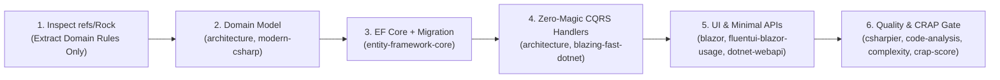
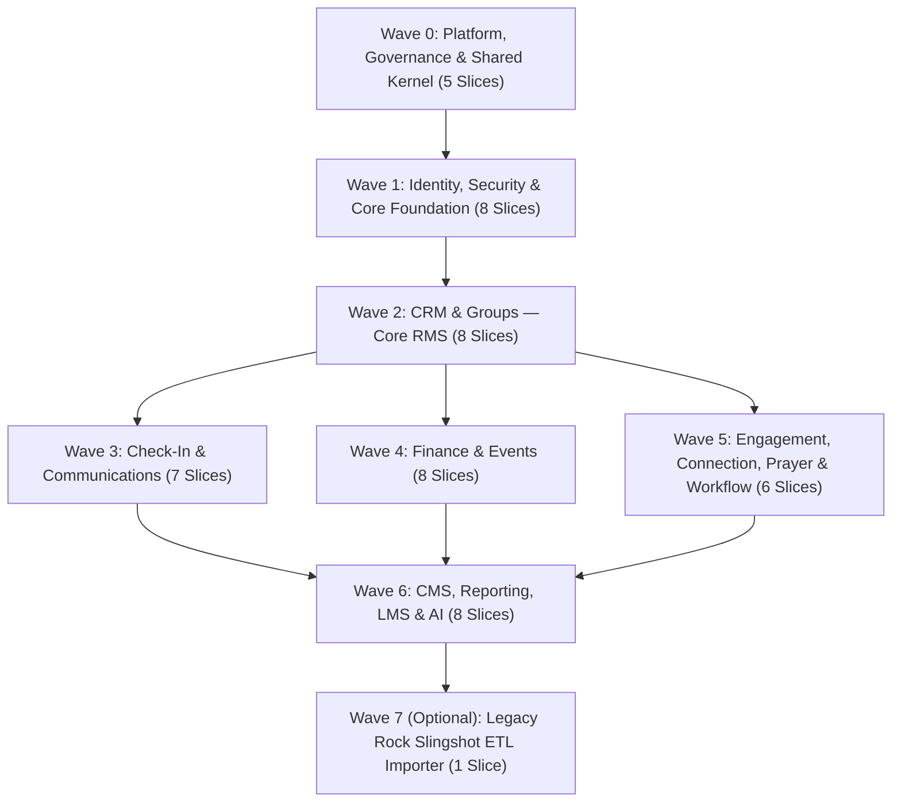

# Ruth — Rock RMS Modernization Implementation Plan

> **Mission:** Port `refs/Rock` (~350 entities, 734 UI blocks, 173 FieldTypes, 226 Reporting Filters/Selects, 145 Workflow Actions, 155 Scheduled Jobs) into a clean, high-performance **.NET 10 + Blazor + Domain-Driven Design (DDD)** Modular Monolith backed by **PostgreSQL 18**, **Redis 8**, and **RustFS (S3)**.

---

## 1. Locked Architectural Decisions

| # | Decision Area | Locked Choice | Architectural Consequence |
| :--- | :--- | :--- | :--- |
| **1** | **Port Strategy** | **Modernize the Stack (Functional & Domain Parity)** | Clean PostgreSQL-native DDD schema (`uuidv7` Strongly-Typed IDs, `timestamptz` / `DateTimeOffset`, `jsonb` + GIN indexes, `postgis`, `pgvector`, Apache `age`). Eliminates `System.Web`, `RockDateTime`, `PersonAlias` FK proliferation, and 10-column EAV `AttributeValue` join bottlenecks. Zero sample data on boot; `/onboarding` locks self-registration after initial admin setup. |
| **2** | **UI Paradigm** | **Option A — Hybrid App Shell + CMS Engine** | **Internal Staff RMS:** Fast, idiomatic Fluent UI Blazor v5 routed pages (`/crm/people/{id}`, `/finance/batches`, `/groups/{id}`) with optional customizable widget zones.<br>**External / Portals / Custom Pages:** Full database-driven `Site -> Layout -> Page -> Zone -> Block` engine rendered via Blazor `<DynamicComponent>` (`IRuthBlock`). |
| **3** | **Blazor Render Modes & APIs** | **`InteractiveServer` (RMS) + `Static SSR` Islands (CMS) + Minimal APIs** | Staff RMS components invoke Application-layer `ICommandHandler`/`IQueryHandler` in-process (zero redundant HTTP DTO client wrappers for internal views). Public CMS uses `Static SSR` + interactive islands. Check-in Kiosk uses a resilient low-latency interactive flow. External/mobile/webhook consumers use ASP.NET Core Minimal APIs + built-in OpenAPI (`AddOpenApi()`). |
| **4** | **CQRS, Messaging & Jobs** | **Zero-Magic Explicit Abstractions** | Custom lightweight `ICommand<T>`, `ICommandHandler<TCommand, T>`, `IQuery<T>`, `IQueryHandler<TQuery, T>`, `IDomainEvent`, `IIntegrationEvent`, and `Result<T>` in `Ruth.SharedKernel` (zero commercial licensing risk from MediatR/MassTransit, zero reflection magic). Per-module EF Core **Transactional Outbox** + `BackgroundService` dispatcher + Postgres-backed `IScheduledJob` runner. |
| **5** | **Extensibility Model** | **Modular Assemblies First** | Clean DI-registered strategy contracts (`IPaymentGateway`, `ICommunicationTransport`, `IStorageProvider`, `IFieldTypePlugin`, `IWorkflowAction`, `IBackgroundCheckProvider`, `IAiProvider`) compiled as modular assemblies, preserving clean seams if dynamic runtime loading is ever desired later. |
| **6** | **Templating & Rendering** | **Compiled Razor Components (`HtmlRenderer`) + Safe Merge Tokens** | Replaces Rock's Lava/Liquid engine. Built-in layouts, transactional emails, contribution statements, and CMS blocks are strongly-typed `.razor` components rendered via Blazor's built-in `HtmlRenderer`. Database-stored, staff-editable content (bulk emails, SMS, waivers, merge fields) uses a safe declarative merge-token engine (`IMergeTemplateEngine` / `TemplateSnippet`) over read-only DTO contexts—eliminating arbitrary runtime scripting/RCE risk. |

---

## 2. Target Solution & Bounded-Context Layout

To satisfy `.agents/skills/architecture` (*"avoid creating extra projects that add ceremony without ownership clarity"*) and `.agents/skills/mcaf` (`MCAF-ARCH-001` canonical vertical-slice identity), each Bounded Context consists of **at most two projects** (`Contracts` + core module containing `Domain`, `Infrastructure`, and `Slices`), with inward dependency rules enforced by `Ruth.ArchitectureTests`.

```text
Ruth.slnx
AGENTS.md                                  # Root repository contract & runnable verification commands
Directory.Build.props                      # net10.0, LangVersion=14, Nullable=enable, TreatWarningsAsErrors=true
Directory.Build.targets
.editorconfig                              # Single source of truth for analyzer severities
CodeMetricsConfig.txt                      # CA1502/CA1505/CA1506 maintainability & complexity thresholds
src/
  Ruth.SharedKernel/                       # AggregateRoot, Entity, ValueObject, StronglyTypedId, Result<T>, IClock, Zero-Magic CQRS & Outbox primitives
  Ruth.Host/                               # ASP.NET Core 10 + Fluent UI Blazor v5 App Shell, /onboarding, Middleware, Composition Root
  Modules/
    Identity/                              # Schema: identity  (Users, Logins, OIDC/JWT, SecurityRoles, Hierarchical ISecured ACLs)
      Ruth.Modules.Identity.Contracts/
      Ruth.Modules.Identity/               # Domain/, Infrastructure/, Slices/<SliceName>/
    Core/                                  # Schema: core      (DefinedTypes, Categories, jsonb Attributes/FieldTypes, Campuses, PostGIS Locations, Schedules, BinaryFiles, Audit, Notes, Tags)
    Crm/                                   # Schema: crm       (People, Households, Apache AGE Relationships, Merge/Deduplication, Badges, Assessments, Protection)
    Groups/                                # Schema: groups    (GroupTypes, Groups, Memberships, Requirements, Serving Scheduler, Attendance)
    CheckIn/                               # Schema: checkin   (Kiosk Config, Family/Individual Matching, Capacity Thresholds, ZPL Labels)
    Communication/                         # Schema: comms     (Razor HtmlRenderer + Safe Merge Engine, Mediums/Transports, Templates, Bulk Email/SMS/Push, Two-Way SMS, Flows)
    Finance/                               # Schema: finance   (Accounts, Gateways, Saved Accounts, Batches, Transactions, Scheduled Giving, Pledges, Statements, Benevolence, Fundraising)
    Events/                                # Schema: events    (Calendars, EventItems, Registrations, Fees/Discounts/Waitlists, Interactive Experiences)
    Engagement/                            # Schema: engage    (Connections, Steps, Streaks, Achievements, Prayer, Reminders, Following, Outreach Touchpoints)
    Workflow/                              # Schema: workflow  (WorkflowTypes, State/Activity/Action Engine, Triggers, Interactive Form Builder)
    Cms/                                   # Schema: cms       (Sites, Layouts, Pages, Zones, Dynamic Blocks, Content Channels, Shortlinks, Media, Interactions, Personalization, Mobile/TV)
    Reporting/                             # Schema: reporting (Query AST DataViews, Reports, MergeTemplates, Metrics, Star-Schema Projections)
    Lms/                                   # Schema: lms       (Programs, Courses, Semesters, Classes, Activities, Grading)
    Ai/                                    # Schema: ai        (Content Collections, pgvector Hybrid Search, AI Providers, Agents & Skills/Tools)
  Providers/                               # Modular provider assemblies (RustFsStorage, Smtp, SendGrid, Mailgun, Nmi, Checkr, OpenAi, etc.)
tests/
  Ruth.ArchitectureTests/                  # Enforces module isolation, Domain purity, sealed handlers/DTOs
  Ruth.Modules.<Context>.Tests/            # Unit + Testcontainers (PostgreSQL 18 / Redis 8 / RustFS) slice tests
```

---

## 3. `.agents/skills` Catalog & Non-Overlapping Ownership Matrix

Every skill in `.agents/skills/` has a distinct role. Per `quality-ci`, **overlapping formatters and linters must never fight over the same files**.

### 3.1 Architecture, Backend & UI Authoring Skills

| Skill | Path | Primary Responsibility & Trigger Scope |
| :--- | :--- | :--- |
| **`mcaf`** | [.agents/skills/mcaf/SKILL.md](file:///Users/reginaldchapple/Developer/Ruth/.agents/skills/mcaf/SKILL.md) | Root and per-module `AGENTS.md` governance, canonical slice naming (`MCAF-ARCH-001`), requirement-to-test traceability (`MCAF-REQ-001`), bounded agent delegation (`MCAF-AI-001`). Only invoke when establishing or updating governance contracts. |
| **`architecture`** | [.agents/skills/architecture/SKILL.md](file:///Users/reginaldchapple/Developer/Ruth/.agents/skills/architecture/SKILL.md) | Modular Monolith boundaries, DDD Aggregates/Entities/Value Objects, Domain vs. Integration Events, Zero-Magic CQRS command/query splits, and vertical slice organization without over-abstraction. |
| **`modern-csharp`** | [.agents/skills/modern-csharp/SKILL.md](file:///Users/reginaldchapple/Developer/Ruth/.agents/skills/modern-csharp/SKILL.md) | Idiomatic C# 14 on `.NET 10`: `sealed` classes/records, primary constructors, `readonly record struct` Strongly-Typed IDs, pattern matching, collection expressions, `System.Threading.Lock`. |
| **`aspnet-core`** | [.agents/skills/aspnet-core/SKILL.md](file:///Users/reginaldchapple/Developer/Ruth/.agents/skills/aspnet-core/SKILL.md) | `Ruth.Host` request pipeline & middleware ordering, `IOptions<T>` configuration, cookie/JWT/OIDC authentication, `IAuthorizationHandler` policies, `IHttpClientFactory`, `BackgroundService` workers, health checks. |
| **`dotnet-webapi`** | [.agents/skills/dotnet-webapi/SKILL.md](file:///Users/reginaldchapple/Developer/Ruth/.agents/skills/dotnet-webapi/SKILL.md) | Minimal API resource endpoints (`Map<Resource>`), `sealed record` Request/Response DTOs with XML `<summary>` docs, `DateTimeOffset`, string enums, `TypedResults`, built-in `AddOpenApi()` (never Swashbuckle), RFC 7807 `ProblemDetails`, and `.http` test files. |
| **`entity-framework-core`** | [.agents/skills/entity-framework-core/SKILL.md](file:///Users/reginaldchapple/Developer/Ruth/.agents/skills/entity-framework-core/SKILL.md) | Per-module `DbContext` & PostgreSQL schema isolation, `IEntityTypeConfiguration<T>`, `jsonb`/`postgis`/`pgvector` mappings, `AsNoTracking()` DTO projections, compiled hot queries, concurrency tokens, reviewable migrations. |
| **`blazor`** | [.agents/skills/blazor/SKILL.md](file:///Users/reginaldchapple/Developer/Ruth/.agents/skills/blazor/SKILL.md) | `.NET 10` render modes (`InteractiveServer` for RMS, `Static SSR` + islands for CMS), `[PersistentState]`, `<ErrorBoundary>`, `<Virtualize>`, `@key` diffing, debounced search, async `IJSRuntime` interop. |
| **`fluentui-blazor-usage`** | [.agents/skills/fluentui-blazor-usage/SKILL.md](file:///Users/reginaldchapple/Developer/Ruth/.agents/skills/fluentui-blazor-usage/SKILL.md) | `Microsoft.FluentUI.AspNetCore.Components` **v5** patterns: `<FluentProviders />`, JS/CSS custom-property theming, `FluentLayout`/`FluentNav`/`FluentNavCategory`, `FluentDataGrid` (`ItemsProvider`), two-parameter `FluentSelect<TOption, TValue>`, `IDialogService` (`IDialogInstance` cascading parameter). |
| **`blazing-fast-dotnet`** | [.agents/skills/blazing-fast-dotnet/SKILL.md](file:///Users/reginaldchapple/Developer/Ruth/.agents/skills/blazing-fast-dotnet/SKILL.md) | Hot-path engineering: `[LoggerMessage]` source-gen logging, STJ `JsonSerializerContext`, `[GeneratedRegex]`, `FrozenDictionary` caches (ACLs, SystemGuids, FieldTypes), `Span<T>`/`SearchValues`, `StringComparison.Ordinal`, `dotnet-counters`/`dotnet-trace` profiling. |

### 3.2 .NET Quality, Formatting, Static Analysis & Risk Gates

| Skill | Path | Ownership Rule (Non-Overlapping) |
| :--- | :--- | :--- |
| **`quality-ci`** | [.agents/skills/quality-ci/SKILL.md](file:///Users/reginaldchapple/Developer/Ruth/.agents/skills/quality-ci/SKILL.md) | Orchestrates the single canonical CI & post-slice verification pass (format -> build/analyze -> tests -> architecture -> coverage). |
| **`csharpier`** | [.agents/skills/csharpier/SKILL.md](file:///Users/reginaldchapple/Developer/Ruth/.agents/skills/csharpier/SKILL.md) | **Exclusive whitespace & layout owner** for `.cs`, `.csproj`, `.props`, `.targets`, and `.slnx` via `dotnet csharpier check .`. |
| **`format`** | [.agents/skills/format/SKILL.md](file:///Users/reginaldchapple/Developer/Ruth/.agents/skills/format/SKILL.md) | Scoped **strictly to `dotnet format style` and `dotnet format analyzers` (`--verify-no-changes`)**—never `whitespace`, so it never conflicts with `csharpier`. |
| **`code-analysis`** | [.agents/skills/code-analysis/SKILL.md](file:///Users/reginaldchapple/Developer/Ruth/.agents/skills/code-analysis/SKILL.md) | First-party .NET 10 SDK analyzers (`EnableNETAnalyzers=true`, `AnalysisLevel=latest-recommended`, `TreatWarningsAsErrors=true`, Security `CA3xxx`/`CA5xxx = error`). Agents must **never** weaken warning gates. |
| **`analyzer-config`** | [.agents/skills/analyzer-config/SKILL.md](file:///Users/reginaldchapple/Developer/Ruth/.agents/skills/analyzer-config/SKILL.md) | Owns the repo-root `.editorconfig` rule severity layout (`root = true`, no inline comments). |
| **`meziantou-analyzer`** | [.agents/skills/meziantou-analyzer/SKILL.md](file:///Users/reginaldchapple/Developer/Ruth/.agents/skills/meziantou-analyzer/SKILL.md) | **Primary third-party Roslyn analyzer pack** (`Meziantou.Analyzer`) catching async/CancellationToken misuse, culture-unsafe string ops, concurrency bugs, and security issues. |
| **`complexity`** | [.agents/skills/complexity/SKILL.md](file:///Users/reginaldchapple/Developer/Ruth/.agents/skills/complexity/SKILL.md) | Enforces `CA1502` (cyclomatic complexity), `CA1505` (maintainability), `CA1506` (class coupling), and `CA1501` via checked-in `CodeMetricsConfig.txt`. |
| **`crap-score`** | [.agents/skills/crap-score/SKILL.md](file:///Users/reginaldchapple/Developer/Ruth/.agents/skills/crap-score/SKILL.md) | Evaluates Change Risk Anti-Patterns (`CRAP < 15` target, never `> 30`) using real Cobertura coverage on complex domain services/engines (ACLs, Merge, Check-In, Template/Merge Engine, DataViews, Batches/Fees, Workflows). |
| **`roslynator`** | [.agents/skills/roslynator/SKILL.md](file:///Users/reginaldchapple/Developer/Ruth/.agents/skills/roslynator/SKILL.md) | **On-demand CLI cleanup & dead-code audit** (`roslynator find-unused`) at the end of each Wave; not stacked as duplicate build errors over SDK + Meziantou. |
| **`stylecop-analyzers`** | [.agents/skills/stylecop-analyzers/SKILL.md](file:///Users/reginaldchapple/Developer/Ruth/.agents/skills/stylecop-analyzers/SKILL.md) | **Scoped opt-in only** if public `Contracts`/API DTO XML documentation rules (`SA1600`) are desired; layout rules stay disabled so `csharpier` remains sole layout owner. |

### 3.3 Frontend Asset, Stylesheet & Runtime Browser Audit Skills

| Skill | Path | Ownership Rule (Non-Overlapping) |
| :--- | :--- | :--- |
| **`biome`** | [.agents/skills/biome/SKILL.md](file:///Users/reginaldchapple/Developer/Ruth/.agents/skills/biome/SKILL.md) | **Primary formatter & linter** (`biome.json`) for Blazor JS/TS interop modules (`wwwroot/**/*.js`, `*.ts`) and static JSON assets. |
| **`stylelint`** | [.agents/skills/stylelint/SKILL.md](file:///Users/reginaldchapple/Developer/Ruth/.agents/skills/stylelint/SKILL.md) | **Stylesheet owner** for custom CSS (`wwwroot/**/*.css`, `.razor.css` isolation styles, Fluent v5 token usage, and CMS themes). |
| **`htmlhint`** | [.agents/skills/htmlhint/SKILL.md](file:///Users/reginaldchapple/Developer/Ruth/.agents/skills/htmlhint/SKILL.md) | Validates **rendered/static HTML output** (exported Email HTML templates, Contribution Statement HTML, and rendered CMS pages)—never raw `.razor` source files. |
| **`webhint`** | [.agents/skills/webhint/SKILL.md](file:///Users/reginaldchapple/Developer/Ruth/.agents/skills/webhint/SKILL.md) | **Runtime URL auditor** (`.hintrc`) checking accessibility (a11y), security headers, performance, PWA signals, and SEO against live `/onboarding`, Staff Shell, Check-in Kiosk, and Public CMS routes. |
| **`eslint`** | [.agents/skills/eslint/SKILL.md](file:///Users/reginaldchapple/Developer/Ruth/.agents/skills/eslint/SKILL.md) | Standby (`not_applicable` by default while `biome` owns JS/TS); activate **only** on bounded rich client packages (e.g., visual Form/Workflow canvas) if specialized ESLint plugins are required. |
| **`sonarjs`** | [.agents/skills/sonarjs/SKILL.md](file:///Users/reginaldchapple/Developer/Ruth/.agents/skills/sonarjs/SKILL.md) | Cognitive-complexity extension (`eslint-plugin-sonarjs`) paired with `eslint` **only** if complex client-side TypeScript editors (ZPL label canvas / Workflow designer) are introduced. |

---

## 4. Standard Slice Execution Contract ("Keeping Implementation Sane")

Every slice (`W<Wave>-S<Slice>`) is an atomic, shippable vertical increment. **Never start N+1 infrastructure for a future wave inside an earlier slice.**



### Definition of Done (Every Slice)
1. **Reference Audit:** Read the mapped `refs/Rock/Rock/Model/...` and `refs/Rock/Rock.Blocks/...` files to capture domain invariants, edge cases, and UX workflows—without copying legacy EF6, `RockContext`, or WebForms patterns.
2. **Domain Purity:** Aggregates enforce invariants via methods returning `Result<T>`, emit `IDomainEvent`s, use `Guid.CreateVersion7()` Strongly-Typed IDs, and have **zero** dependencies on EF Core, ASP.NET Core, or Blazor.
3. **Persistence:** Module-scoped `DbContext` + explicit `IEntityTypeConfiguration<T>` + reviewable EF Core migration + `AsNoTracking()` read projections.
4. **Presentation:** Fluent UI Blazor v5 pages/dialogs (with `<ErrorBoundary>`, loading states, and ACL checks) and/or Minimal API endpoints (`TypedResults` + OpenAPI metadata + `.http` requests).
5. **Automated Tests:** Domain unit tests + Testcontainers PostgreSQL 18 integration tests + `Ruth.ArchitectureTests` green.
6. **Post-Slice Quality Gate:**
   - `dotnet csharpier check .` (`csharpier`)
   - `dotnet build Ruth.slnx -warnaserror` (`code-analysis`, `meziantou-analyzer`, `complexity`)
   - `dotnet format style Ruth.slnx --verify-no-changes && dotnet format analyzers Ruth.slnx --verify-no-changes` (`format`)
   - `dotnet test` with Cobertura coverage + `crap-score` check (`CRAP < 15`) on newly added complex domain methods.

---

## 5. Wave Dependency Roadmap



> [!TIP]
> Once **Wave 2 (CRM & Groups)** is complete, **Waves 3, 4, and 5** depend primarily on `Identity`, `Core`, `Crm.Contracts`, and `Groups.Contracts`—meaning slices across Check-In/Comms, Finance/Events, and Engagement/Workflow can be executed **in parallel** (e.g., via `/teamwork` swarm workers in isolated workspaces).

---

## 6. Detailed Wave & Vertical Slice Catalog

### Wave 0 — Platform, Governance & Shared Kernel
*Goal: Establish repository governance, zero-warning CI gates, DDD/CQRS building blocks, Docker infrastructure, and the Fluent UI v5 host shell with zero-seed `/onboarding`.*

#### `W0-S1` — Repository Governance, Solution Skeleton & Quality Gates ✅ *(Completed)*
* **Scope:** Rebrand remaining template files ([Dockerfile](file:///Users/reginaldchapple/Developer/Ruth/deploy/docker/dotnet/Dockerfile), `docker-compose.yml`) to `Ruth`; create root `AGENTS.md`, `Ruth.slnx`, `Directory.Build.props` (`net10.0`, `LangVersion=14`, `TreatWarningsAsErrors=true`, `EnableNETAnalyzers=true`, `Meziantou.Analyzer`), repo-root `.editorconfig`, `CodeMetricsConfig.txt`, local `csharpier` tool manifest, `biome.json`, `stylelint.config.mjs`, and `tests/Ruth.ArchitectureTests`.
* **`refs/Rock` Reference:** `Directory.Build.props`, `CLAUDE.md` (conceptual domain boundaries only).
* **Authoring Skills:** `mcaf`, `architecture`, `quality-ci`, `analyzer-config`, `code-analysis`, `meziantou-analyzer`, `complexity`, `csharpier`, `biome`, `stylelint`.
* **Verification Skills:** `quality-ci`, `csharpier`, `format`, `code-analysis`.

#### `W0-S2` — `Ruth.SharedKernel` (DDD & Zero-Magic CQRS Primitives) ✅ *(Completed)*
* **Scope:** `Entity<TId>`, `AggregateRoot<TId>`, `IStronglyTypedId<T>` (`Guid.CreateVersion7()`), `ValueObject`, `Result` / `Result<T>` / `Error`, `IClock` (`TimeProvider` adapter), `IDomainEvent` / `IDomainEventHandler<T>`, `IIntegrationEvent` / `IIntegrationEventHandler<T>`, explicit DI-dispatched `ICommand<TResponse>` / `ICommandHandler<TCommand, TResponse>` and `IQuery<TResponse>` / `IQueryHandler<TQuery, TResponse>` with logging/validation decorator pipeline.
* **`refs/Rock` Reference:** Replaces `Rock/Data/Entity.cs`, `Rock/Data/IEntity.cs`, `RockDateTime`.
* **Authoring Skills:** `architecture`, `modern-csharp`, `blazing-fast-dotnet`.
* **Verification Skills:** `csharpier`, `code-analysis`, `complexity`, `crap-score`.

#### `W0-S3` — Module Persistence Base, Transactional Outbox & Scheduled Job Engine ✅ *(Completed)*
* **Scope:** Abstract `ModuleDbContext` (Npgsql 18 with `postgis`, `pgvector`, `age` readiness), audit timestamp/concurrency `SaveChangesInterceptor`, per-schema `OutboxMessage` + `InboxMessage` tables, `BackgroundService` Outbox dispatcher, and Postgres-advisory-locked cron `IScheduledJob` engine (replacing Quartz `ServiceJob` / `ServiceJobHistory`).
* **`refs/Rock` Reference:** `Rock/Model/Core/ServiceJob`, `ServiceJobHistory`, `ServiceLog`, `Rock/Transactions`, `Rock/Bus`.
* **Authoring Skills:** `entity-framework-core`, `architecture`, `aspnet-core`, `modern-csharp`, `blazing-fast-dotnet`.
* **Verification Skills:** `csharpier`, `code-analysis`, `complexity`, `crap-score`.

#### `W0-S4` — `Ruth.Host` Pipeline, Observability & Fluent UI Blazor v5 App Shell ✅ *(Completed)*
* **Scope:** `Program.cs` middleware pipeline (`ApiExceptionHandler` -> HTTPS -> `MapStaticAssets` -> Routing -> Auth -> RateLimiter -> OutputCache -> Endpoints), built-in `AddOpenApi()`, `/health` checks (Postgres, Redis, RustFS), OpenTelemetry logging/metrics/tracing, `<FluentProviders />`, `MainLayout.razor` (`FluentLayout`, `FluentNav`, light/dark theme toggle via `Blazor.theme`, `<ErrorBoundary>`).
* **`refs/Rock` Reference:** `Rock.WebStartup`, `Rock/Observability`, `Rock/Model/Core/ExceptionLog`.
* **Authoring Skills:** `aspnet-core`, `blazor`, `fluentui-blazor-usage`, `dotnet-webapi`, `stylelint`, `biome`.
* **Verification Skills:** `csharpier`, `code-analysis`, `webhint` (against local host shell).

#### `W0-S5` — Zero-Seed First-Run `/onboarding` & Production Startup Guards ✅ *(Completed)*
* **Scope:** Production fail-fast validator if `Authentication:Jwt:SigningKey` uses dev default; onboarding state gate middleware redirecting all routes to `/onboarding` when zero admin users exist; one-time Administrator + Organization setup wizard that permanently locks self-registration upon completion (matching [.env.example](file:///Users/reginaldchapple/Developer/Ruth/.env.example)).
* **`refs/Rock` Reference:** Modernizes Rock's first-run installer/admin setup flow.
* **Authoring Skills:** `aspnet-core`, `blazor`, `fluentui-blazor-usage`, `entity-framework-core`, `modern-csharp`.
* **Verification Skills:** `csharpier`, `code-analysis`, `webhint`, `crap-score`.

---

### Wave 1 — Identity, Security & Core Foundation
*Goal: Deliver Rock's authentication, hierarchical Allow/Deny entity security, extensible `jsonb` attributes/FieldTypes, PostGIS locations, iCal schedules, and RustFS storage.*

#### `W1-S1` — Authentication, User Logins & OIDC/JWT Providers ✅ *(Completed)*
* **Scope:** `Identity` module (`identity` schema): `UserAccount` (`UserLogin`), Argon2id/ASP.NET Core password hashing, Cookie auth for Blazor Server, JWT Bearer + Refresh Tokens for APIs/Mobile, external OIDC provider abstraction, password reset & account confirmation flows, login history, `Auth.http`.
* **`refs/Rock` Reference:** `Rock/Model/CRM/UserLogin`, `PersonToken`, `RemoteAuthenticationSession`, `Rock.Oidc`, `Rock.Blocks/Security/Login.cs`, `AccountEntry.cs`, `ChangePassword.cs`, `LoginHistory.cs`.
* **Authoring Skills:** `aspnet-core`, `architecture`, `entity-framework-core`, `dotnet-webapi`, `blazor`, `fluentui-blazor-usage`, `modern-csharp`.
* **Verification Skills:** `csharpier`, `code-analysis`, `complexity`, `crap-score`.

#### `W1-S2` — Security Roles & Hierarchical `ISecured` ACL Engine ✅ *(Completed)*
* **Scope:** `SecurityRole` (extracted cleanly out of legacy `Group`), special roles (`AllUsers`, `AllAuthenticatedUsers`), `EntityAclRule` (`Auth`: ordered `Allow`/`Deny` per action `View`, `Edit`, `Administrate`, etc. with parent-entity hierarchy inheritance), `AuthAuditLog`, `RestApiKey` (`RestKeyDetail`), `AuthClient`/`AuthScope`, Redis-backed `FrozenDictionary` ACL evaluator + ASP.NET Core `IAuthorizationHandler` + reusable Blazor `<SecurityDialog />`.
* **`refs/Rock` Reference:** `Rock/Security/Authorization.cs`, `ISecured.cs`, `Rock/Model/Core/Auth`, `AuthAuditLog`, `AuthClient`, `AuthScope`, `Rock.Blocks/Security/VerifySecurity.cs`, `SecurityChangeAuditList.cs`, `RestKeyList.cs`.
* **Authoring Skills:** `architecture`, `aspnet-core`, `blazing-fast-dotnet`, `entity-framework-core`, `fluentui-blazor-usage`, `blazor`.
* **Verification Skills:** `csharpier`, `code-analysis`, `complexity`, `crap-score` (critical security engine: mandatory near-100% branch coverage).

#### `W1-S3` — Entity Registry, DefinedTypes & Hierarchical Categories ✅ *(Completed)*
* **Scope:** `Core` module (`core` schema): `EntityTypeDescriptor` (compile-time discovered modular entity registry + `SystemGuid` constants), `DefinedType` + `DefinedValue` aggregate, recursive `Category` tree aggregate, Redis/memory read caches, Admin UI screens (`DefinedTypeList`, `DefinedTypeDetail`, `CategoryTreeView`).
* **`refs/Rock` Reference:** `Rock/Model/Core/EntityType`, `DefinedType`, `DefinedValue`, `Category`, `Rock/SystemGuid`, `Rock.Blocks/Core/DefinedTypeList.cs`, `DefinedTypeDetail.cs`, `CategoryDetail.cs`.
* **Authoring Skills:** `architecture`, `entity-framework-core`, `blazor`, `fluentui-blazor-usage`, `blazing-fast-dotnet`.
* **Verification Skills:** `csharpier`, `code-analysis`, `complexity`.

#### `W1-S4` — Typed `jsonb` Attribute Engine, Attribute Matrices & Core FieldTypes ✅ *(Completed)*
* **Scope:** `AttributeDefinition` (global, entity-type, or entity-qualifier scoped), `AttributeMatrixTemplate` (repeatable structured sub-rows in `jsonb`), `IHasAttributes` `jsonb` column convention + GIN index helper, and modular `IFieldTypePlugin` registry (starting with the ~25 foundational FieldTypes: Text, Memo, Boolean, Integer, Decimal, Currency, Date, DateTime, DateRange, SingleSelect, MultiSelect, DefinedValue, Category, KeyValueList, Json/Code, Color, Url, Email, Phone, Rating, Matrix) + dynamic `<AttributeValuesEditor />` and `<AttributeValuesSummary />` Blazor components.
* **`refs/Rock` Reference:** `Rock/Model/Core/Attribute`, `AttributeQualifier`, `AttributeValue`, `AttributeMatrix*`, `FieldType`, `Rock/Field/Types/*`, `Rock.Blocks/Core/Attributes.cs`, `AttributeMatrixTemplateDetail.cs`.
* **Authoring Skills:** `architecture`, `entity-framework-core`, `blazor`, `fluentui-blazor-usage`, `modern-csharp`, `blazing-fast-dotnet`.
* **Verification Skills:** `csharpier`, `code-analysis`, `complexity`, `crap-score`.

#### `W1-S5` — Campuses, PostGIS Locations & Physical Devices ✅ *(Completed)*
* **Scope:** `Campus` (`CampusSchedule`, `CampusTopic`), `Location` hierarchy (buildings, rooms, named locations, street addresses) with `NetTopologySuite` **PostGIS** `geography(Point, 4326)` & `geography(Polygon, 4326)` geofences, `IAddressVerificationProvider` / geocoding hook, `Device` (kiosks, label printers, check-in tablets, IP/Geo matching).
* **`refs/Rock` Reference:** `Rock/Model/Core/Campus*`, `Location`, `Device`, `NcoaHistory`, `Rock/Address`, `Rock.Blocks/Core/CampusList.cs`, `LocationTree.cs`, `LocationDetail.cs`, `DeviceDetail.cs`.
* **Authoring Skills:** `architecture`, `entity-framework-core`, `blazor`, `fluentui-blazor-usage`, `dotnet-webapi`.
* **Verification Skills:** `csharpier`, `code-analysis`, `complexity`.

#### `W1-S6` — Schedules & iCalendar Recurrence Engine ✅ *(Completed)*
* **Scope:** `Schedule` aggregate (`iCalendarContent` RFC 5545 RRULEs, check-in start/end offsets, `ScheduleDate` materialized horizon table for fast SQL range joins, `ScheduleCategoryExclusion`), friendly schedule text formatter, `<ScheduleBuilderDialog />` Blazor component.
* **`refs/Rock` Reference:** `Rock/Model/Core/Schedule`, `ScheduleDate`, `ScheduleCategoryExclusion`, `Rock.Blocks/Core/ScheduleList.cs`, `ScheduleDetail.cs`, `ScheduleCategoryExclusionList.cs`.
* **Authoring Skills:** `architecture`, `modern-csharp`, `entity-framework-core`, `blazor`, `fluentui-blazor-usage`, `blazing-fast-dotnet`.
* **Verification Skills:** `csharpier`, `code-analysis`, `complexity`, `crap-score` (recurrence & timezone math must have exhaustive DST/leap-year tests).

#### `W1-S7` — BinaryFiles, Documents, Electronic Signatures & RustFS Storage ✅ *(Completed)*
* **Scope:** `IStorageProvider` + `RustFsStorageProvider` (S3 presigned URLs & streaming uploads), `BinaryFileType`, `BinaryFile`, image crop/avatar processor, `DocumentType`/`Document`, `SignatureDocumentTemplate`/`SignatureDocument` electronic signature capture, `<FileUploader />` & `<ImageEditor />` Blazor components.
* **`refs/Rock` Reference:** `Rock/Model/Core/AssetStorageProvider`, `BinaryFile*`, `Document*`, `SignatureDocument*`, `Rock/Storage`, `Rock.Blocks/Core/BinaryFileDetail.cs`, `SignatureDocumentTemplateDetail.cs`.
* **Authoring Skills:** `architecture`, `aspnet-core`, `entity-framework-core`, `dotnet-webapi`, `blazor`, `fluentui-blazor-usage`.
* **Verification Skills:** `csharpier`, `code-analysis`, `complexity`.

#### `W1-S8` — Audit History, Notes, Tags, EntitySets & User Preferences ✅ *(Completed)*
* **Scope:** Structured `HistoryLog` (`History` / `Audit` domain change timeline), `NoteType`/`Note`/`NoteAttachment`/`NoteWatch` threaded notes timeline component, personal & organizational `Tag`/`TaggedItem` autocomplete pill bar, ephemeral/saved `EntitySet` bulk selection sets, `PersonPreference` key-value store.
* **`refs/Rock` Reference:** `Rock/Model/Core/Audit*`, `History`, `Note*`, `Tag`, `TaggedItem`, `EntitySet*`, `PersonPreference`, `Rock.Blocks/Core/NoteTypeList.cs`, `TagList.cs`, `HistoryLog.cs`.
* **Authoring Skills:** `architecture`, `entity-framework-core`, `blazor`, `fluentui-blazor-usage`, `modern-csharp`.
* **Verification Skills:** `csharpier`, `code-analysis`, `complexity`.

---

### Wave 2 — CRM & Groups (The Heart of the RMS)
*Goal: Deliver Rock's complete Person 360 profile, Household/Relationship graph, deduplication/merge, ministry groups, serving schedules, and attendance.*

#### `W2-S1` — Person Aggregate, Contact Info, Metaphones & Fast Person Search ✅ *(Completed)*
* **Scope:** `Crm` module (`crm` schema): `Person` aggregate (record type Person/Business/RestUser, connection status, record status, marital status, BirthDate, graduation/grade calculation, deceased handling, photo), `PhoneNumber` (E.164 normalization, SMS opt-in), `PersonPreviousName`, `PersonSearchKey` (alternate emails/barcodes/legacy IDs), `Metaphone` / `MetaFirstNameGenderLookup` / `MetaNickNameLookup`, PostgreSQL `pg_trgm` + phonetic instant search bar & Person Profile header.
* **`refs/Rock` Reference:** `Rock/Model/CRM/Person`, `PhoneNumber`, `PersonPreviousName`, `PersonSearchKey`, `Rock/Model/Meta/*`, `Rock.Blocks/Crm/PersonDetail`, `PersonSearch.cs`.
* **Authoring Skills:** `architecture`, `modern-csharp`, `entity-framework-core`, `blazor`, `fluentui-blazor-usage`, `blazing-fast-dotnet`.
* **Verification Skills:** `csharpier`, `code-analysis`, `complexity`, `crap-score`.

#### `W2-S2` — Households (Families) & Apache AGE Relationship Graph ✅ *(Completed)*
* **Scope:** First-class `Household` aggregate (replacing overloaded Family `Group`s: Adult/Child roles, Primary Campus, Mapped Mailing/Home `Location`s, Combined Giving Unit flag, multi-household membership for blended families) + `KnownRelationship` & `PeerNetwork` graph synchronized to **PostgreSQL Apache AGE** (`crm_graph`) for multi-hop family/influence/relationship traversal, plus Household UI cards on Person Profile.
* **`refs/Rock` Reference:** Family logic in `Rock/Model/CRM/Person`, `Rock/Model/Group/PeerNetwork`, `Rock.Blocks/Crm/PersonDetail/EditFamily.cs`, `Relationships.cs`, `FamilyPreRegistration.cs`.
* **Authoring Skills:** `architecture`, `entity-framework-core`, `blazor`, `fluentui-blazor-usage`, `modern-csharp`.
* **Verification Skills:** `csharpier`, `code-analysis`, `complexity`, `crap-score`.

#### `W2-S3` — Person Duplicate Detection, Alias Redirects & Cross-Module Merge ✅ *(Completed)*
* **Scope:** Scheduled `PersonDuplicateScannerJob` (`PersonDuplicate` confidence scoring across name/nicknames/phone/email/address/DOB), `PersonRedirectLedger` (maps retired `PersonId`s and legacy `PersonAlias` GUIDs to surviving `PersonId`), side-by-side Blazor `<PersonMergePage />`, and `PersonMergedIntegrationEvent` via Outbox so every downstream module (`Groups`, `Finance`, `CheckIn`, etc.) re-points `PersonId` cleanly.
* **`refs/Rock` Reference:** `Rock/Model/CRM/PersonDuplicate`, `PersonAlias`, `Rock/Jobs/PersonDuplicateFinder.cs`, `Rock.Blocks/Crm/PersonDuplicateList.cs`, `PersonMerge.cs`.
* **Authoring Skills:** `architecture`, `entity-framework-core`, `blazor`, `fluentui-blazor-usage`, `blazing-fast-dotnet`.
* **Verification Skills:** `csharpier`, `code-analysis`, `complexity`, `crap-score` (high-risk data mutation: thorough Testcontainers merge tests).

#### `W2-S4` — Signals, Extensible Badges, Assessments & Background Checks ✅ *(Completed)*
* **Scope:** `SignalType` / `PersonSignal` (top-of-profile safety/VIP banners), modular `IPersonBadge` Blazor component bar (`Badge`), `AssessmentType` / `Assessment` (Spiritual Gifts, DISC, Conflict, Motivators, Emotional Intelligence), `BackgroundCheck` + `IBackgroundCheckProvider` (including modular Checkr webhook adapter), `IdentityVerification`, and `PersonViewed` audit log.
* **`refs/Rock` Reference:** `Rock/Model/Core/PersonSignal`, `SignalType`, `Rock/Model/CRM/Badge`, `Assessment*`, `BackgroundCheck`, `IdentityVerification*`, `PersonViewed`, `Rock.Checkr`, `Rock.Blocks/Crm/Assessment*`, `BadgeDetail.cs`, `Rock.Blocks/Security/BackgroundCheck/*`.
* **Authoring Skills:** `architecture`, `aspnet-core`, `dotnet-webapi`, `entity-framework-core`, `blazor`, `fluentui-blazor-usage`.
* **Verification Skills:** `csharpier`, `code-analysis`, `complexity`.

#### `W2-S5` — GroupTypes, Group Hierarchy, Locations & PostGIS Group Finder ✅ *(Completed)*
* **Scope:** `Groups` module (`groups` schema): `GroupType` (`GroupTypeRole`, allowed child GroupTypes, location modes, attendance rules), `Group` tree aggregate, `GroupLocation`, `GroupDemographicType`/`Value`, `GroupHistorical` snapshots, Admin `GroupTreeView`/`GroupDetail` shell, and public/internal PostGIS radius/polygon `GroupFinder` + map view.
* **`refs/Rock` Reference:** `Rock/Model/Group/Group`, `GroupType*`, `GroupLocation*`, `GroupDemographic*`, `GroupHistorical`, `Rock.Blocks/Group/GroupTreeView.cs`, `GroupDetail.cs`, `GroupTypeDetail.cs`, `GroupFinder.cs`, `GroupMap.cs`.
* **Authoring Skills:** `architecture`, `entity-framework-core`, `blazor`, `fluentui-blazor-usage`, `modern-csharp`.
* **Verification Skills:** `csharpier`, `code-analysis`, `complexity`.

#### `W2-S6` — Group Memberships, Requirements, Placement & Sync ✅ *(Completed)*
* **Scope:** `GroupMember` lifecycle (Active, Inactive, Pending, capacity/role limits, `GroupMemberHistorical`), `GroupRequirementType` / `GroupRequirement` / `GroupMemberRequirement` (background check/step/attribute prerequisites), `GroupPlacement` board, `GroupSimpleRegister`, and scheduled `GroupSync` reconciliation.
* **`refs/Rock` Reference:** `Rock/Model/Group/GroupMember`, `GroupMemberHistorical`, `GroupRequirement*`, `GroupSync`, `Rock.Blocks/Group/GroupMemberList.cs`, `GroupPlacement.cs`, `GroupRequirementTypeDetail.cs`.
* **Authoring Skills:** `architecture`, `entity-framework-core`, `blazor`, `fluentui-blazor-usage`, `modern-csharp`.
* **Verification Skills:** `csharpier`, `code-analysis`, `complexity`, `crap-score`.

#### `W2-S7` — Ministry Serving Scheduler & RSVPs ✅ *(Completed)*
* **Scope:** `GroupMemberScheduleTemplate`, `GroupLocationScheduleConfig` (min/desired/max volunteer thresholds), `GroupMemberAssignment`, `PersonScheduleExclusion` (blackout dates), `GroupScheduleExclusion`, interactive Coordinator Schedule Grid + Volunteer Schedule Toolbox & Decline/Accept RSVP links (`Rsvp`).
* **`refs/Rock` Reference:** `Rock/Model/Group/GroupMemberScheduleTemplate`, `GroupLocationScheduleConfig`, `GroupMemberAssignment`, `PersonScheduleExclusion`, `Rock.Blocks/Group/Scheduling/*`, `Rock.Blocks/Rsvp/*`.
* **Authoring Skills:** `architecture`, `entity-framework-core`, `blazor`, `fluentui-blazor-usage`, `modern-csharp`.
* **Verification Skills:** `csharpier`, `code-analysis`, `complexity`, `crap-score`.

#### `W2-S8` — Attendance Occurrences & Group Attendance Entry ✅ *(Completed)*
* **Scope:** `AttendanceOccurrence` (Group + Location + Schedule + OccurrenceDate, `DidNotOccur`), `Attendance` records, fast mobile/tablet-friendly Group Roster Attendance checklist UI, Campus/Service metric summary hooks, and `PersonAttendedIntegrationEvent`.
* **`refs/Rock` Reference:** `Rock/Model/Event/AttendanceOccurrence`, `Attendance`, `Rock.Blocks/Group/GroupAttendanceList.cs`, `GroupAttendanceDetail.cs`.
* **Authoring Skills:** `architecture`, `entity-framework-core`, `blazor`, `fluentui-blazor-usage`, `dotnet-webapi`.
* **Verification Skills:** `csharpier`, `code-analysis`, `complexity`.

---

### Wave 3 — Check-In & Communications
*Goal: Deliver Sunday-morning mission-critical Kiosk Check-In, ZPL label printing, the Razor & safe merge-token template engine, and multi-channel communications.*

#### `W3-S1` — Razor Template Renderer, Safe Merge Tokens & Reusable Snippets
* **Scope:** `IRazorTemplateRenderer` built on Blazor's native `.NET 10` `HtmlRenderer` (rendering strongly-typed `.razor` component templates to HTML/text with DI support) paired with `IMergeTemplateEngine` for database-stored, staff-editable content (emails, SMS, signature waivers, ZPL/text): compiled token parser (`{{ Field }}` with safe built-in formatters for dates, currency, casing, fallback defaults, and HTML encoding), strict size/recursion limits, reusable `TemplateSnippet` definitions, and read-only DTO merge contexts (never exposing `DbContext`, mutable domain entities, or arbitrary runtime C# execution).
* **`refs/Rock` Reference:** Functional parity for `Rock/Model/CMS/LavaShortCode` & `Rock.Blocks/Cms/LavaShortcodeDetail.cs` (re-architected onto native `.NET 10` Razor components + safe merge tokens instead of Lava/Liquid).
* **Authoring Skills:** `architecture`, `modern-csharp`, `blazing-fast-dotnet`, `blazor`, `fluentui-blazor-usage`.
* **Verification Skills:** `csharpier`, `code-analysis`, `complexity`, `crap-score`.

#### `W3-S2` — Check-In Configuration, Areas, Rules & Room Balancing
* **Scope:** `CheckIn` module (`checkin` schema): Check-in configuration profiles, Area/Group/Location/Schedule matrices, matching specifications (Age range, Birthdate, Grade, Ability level, Gender, Special Needs, Already-Enrolled), room capacity thresholds, and automated room-balancing domain service.
* **`refs/Rock` Reference:** `Rock/CheckIn/v2/*` configuration & filtering services, `Rock.Blocks/CheckIn/Config/*`, `CheckInScheduleBuilder.cs`.
* **Authoring Skills:** `architecture`, `modern-csharp`, `entity-framework-core`, `blazor`, `fluentui-blazor-usage`, `blazing-fast-dotnet`.
* **Verification Skills:** `csharpier`, `code-analysis`, `complexity`, `crap-score`.

#### `W3-S3` — High-Throughput Check-In Session Engine, Kiosk UI & Classroom Manager
* **Scope:** `AttendanceCheckInSession`, collision-free daily `AttendanceCode` generator (configurable alpha/numeric security codes with bad-word filter), sub-50ms phone-number/family/barcode search, touch-optimized Blazor Check-In Kiosk UI + Check-Out flow + Next-Gen Manager classroom roster/override tablet UI + Mobile Check-In Minimal APIs.
* **`refs/Rock` Reference:** `Rock/CheckIn/v2/*`, `Rock/Model/Event/AttendanceCheckInSession`, `AttendanceCode`, `AttendanceData`, `Rock.Blocks/CheckIn/AttendanceHistoryList.cs`, `Manager/*`, `Rock.Blocks/Mobile/CheckIn/*`.
* **Authoring Skills:** `architecture`, `blazing-fast-dotnet`, `entity-framework-core`, `blazor`, `fluentui-blazor-usage`, `dotnet-webapi`, `stylelint`.
* **Verification Skills:** `csharpier`, `code-analysis`, `complexity`, `crap-score`, `webhint` (Kiosk touch/a11y/perf audit).

#### `W3-S4` — Check-In Label Designer & Zebra ZPL Print Pipeline
* **Scope:** `CheckInLabel` aggregate (JSON layout schema + ZPL compilation), merge fields (Security Code, Allergies/Legal Notes, Room, Parent Receipt, Achievement icons), server TCP raw-socket printer dispatch (for local/VPN Zebra printers) + browser local-print/WebUSB JS interop module, and visual Blazor Label Preview/Editor.
* **`refs/Rock` Reference:** `Rock/Model/Core/CheckInLabel`, `Rock/CheckIn/v2/Labels/*`, `Checkin Labels/`, `Rock.Blocks/CheckIn/Config/CheckInLabelDetail.cs`.
* **Authoring Skills:** `architecture`, `modern-csharp`, `blazing-fast-dotnet`, `blazor`, `fluentui-blazor-usage`, `biome`.
* **Verification Skills:** `csharpier`, `code-analysis`, `biome`, `complexity`, `crap-score`.

#### `W3-S5` — Communication Transports, System Communications & Snippets
* **Scope:** `Communication` module (`comms` schema): `ICommunicationTransport` modular contracts + providers (SMTP, SendGrid, Mailgun, Twilio SMS, Push Notification stub, Dev In-Memory Sink), `SystemCommunication` transactional email/SMS templates (wired to Identity/Group/Workflow events), `SystemPhoneNumber`, `SnippetType`/`Snippet`, `PersonalDevice` push tokens.
* **`refs/Rock` Reference:** `Rock/Communication/*`, `Rock.Mailgun`, `Rock.SendGrid`, `Rock.Mandrill`, `Rock/Model/Communication/SystemCommunication`, `SystemPhoneNumber`, `Snippet*`, `Rock/Model/CRM/PersonalDevice`, `Rock.Blocks/Communication/SystemCommunicationDetail.cs`.
* **Authoring Skills:** `architecture`, `aspnet-core`, `entity-framework-core`, `blazor`, `fluentui-blazor-usage`, `htmlhint` (email HTML output validation).
* **Verification Skills:** `csharpier`, `code-analysis`, `htmlhint`, `complexity`.

#### `W3-S6` — Bulk Communications, Email Builder, Recipients & Two-Way SMS Pipeline
* **Scope:** `CommunicationTemplate`, `EmailSection` structured email composer, `Communication` lifecycle (Draft -> Pending Approval -> Approved -> Sending -> Sent), `CommunicationRecipient` batch sending job, bounce/open/click webhook Minimal APIs, unsubscribe management, two-way SMS Conversations inbox (`CommunicationResponse`) + `SmsPipeline`/`SmsAction` keyword responder.
* **`refs/Rock` Reference:** `Rock/Model/Communication/Communication*`, `EmailSection`, `SmsPipeline`, `SmsAction`, `Rock.Blocks/Communication/CommunicationEntryWizard.cs`, `CommunicationDetail.cs`, `Communications.cs`, `SmsConversations.cs`, `SmsPipelineDetail.cs`.
* **Authoring Skills:** `architecture`, `aspnet-core`, `dotnet-webapi`, `entity-framework-core`, `blazor`, `fluentui-blazor-usage`, `htmlhint`, `stylelint`.
* **Verification Skills:** `csharpier`, `code-analysis`, `htmlhint`, `complexity`, `crap-score`.

#### `W3-S7` — Communication Flows & Automated Drip Campaigns
* **Scope:** `CommunicationFlow` (multi-step timed drip sequences, exit/conversion conditions), `CommunicationFlowInstance`, `CommunicationFlowInstanceRecipient`, `CommunicationFlowInstanceCommunicationConversion`, Flow Builder & Performance Analytics UI.
* **`refs/Rock` Reference:** `Rock/Model/Communication/CommunicationFlow*`, `Rock.Blocks/Communication/CommunicationFlowDetail.cs`, `CommunicationFlowPerformance.cs`.
* **Authoring Skills:** `architecture`, `entity-framework-core`, `blazor`, `fluentui-blazor-usage`, `modern-csharp`.
* **Verification Skills:** `csharpier`, `code-analysis`, `complexity`, `crap-score`.

---

### Wave 4 — Finance & Events
*Goal: Deliver Rock's complete accounting/giving ledger, payment gateways, statements, benevolence, fundraising, calendars, and paid event registrations.*

#### `W4-S1` — Financial Accounts, Giving Units, Businesses & Pledges
* **Scope:** `Finance` module (`finance` schema): hierarchical `FinancialAccount` (tax-deductible flags, campus mapping, GL codes, start/end dates), `Money` value object (strict decimal currency invariants), Business CRM facade (`BusinessList`, `BusinessDetail`, `ConvertBusiness`), and `FinancialPledge` tracking + analytics.
* **`refs/Rock` Reference:** `Rock/Model/Finance/FinancialAccount`, `FinancialPledge`, `Rock.Blocks/Finance/FinancialAccountDetail.cs`, `AccountTreeView.cs`, `BusinessDetail.cs`, `FinancialPledgeDetail.cs`.
* **Authoring Skills:** `architecture`, `modern-csharp`, `entity-framework-core`, `blazor`, `fluentui-blazor-usage`.
* **Verification Skills:** `csharpier`, `code-analysis`, `complexity`.

#### `W4-S2` — Payment Gateways & Tokenized Saved Accounts
* **Scope:** `FinancialGateway` configuration, modular `IPaymentGateway` (hosted tokenizer JS interop, ACH/card charge, refund, customer vault, scheduled subscription sync), Test Gateway + modular `NmiGatewayProvider` (`Rock.NMI` port), `FinancialPersonSavedAccount` & hashed routing/account `FinancialPersonBankAccount` (for check-micr matching).
* **`refs/Rock` Reference:** `Rock/Financial/*`, `Rock.NMI`, `Rock/Model/Finance/FinancialGateway`, `FinancialPaymentDetail`, `FinancialPersonSavedAccount`, `FinancialPersonBankAccount`, `Rock.Blocks/Finance/FinancialGatewayDetail.cs`, `SavedAccountList.cs`.
* **Authoring Skills:** `architecture`, `aspnet-core`, `dotnet-webapi`, `entity-framework-core`, `blazor`, `fluentui-blazor-usage`, `biome`.
* **Verification Skills:** `csharpier`, `code-analysis`, `biome`, `complexity`, `crap-score`.

#### `W4-S3` — Financial Batches, Transactions, Refunds & Check Scanning API
* **Scope:** `FinancialBatch` aggregate (Pending -> Open -> Closed state machine, control amount/count reconciliation, audit locks), `FinancialTransaction` + `FinancialTransactionDetail` multi-account splits, `FinancialTransactionImage` (RustFS encrypted check images), `FinancialTransactionRefund` partial/full refunds, Batch/Transaction RMS screens + Minimal API for check-scanner uploads.
* **`refs/Rock` Reference:** `Rock/Model/Finance/FinancialBatch`, `FinancialTransaction*`, `Rock.Blocks/Finance/FinancialBatchList.cs`, `FinancialBatchDetail.cs`, `TransactionList.cs`, `TransactionDetail.cs`.
* **Authoring Skills:** `architecture`, `modern-csharp`, `entity-framework-core`, `dotnet-webapi`, `blazor`, `fluentui-blazor-usage`.
* **Verification Skills:** `csharpier`, `code-analysis`, `complexity`, `crap-score` (financial invariants require exhaustive unit + concurrency tests).

#### `W4-S4` — Scheduled Giving & Giving Automation Alerts
* **Scope:** `FinancialScheduledTransaction` + `FinancialScheduledTransactionDetail`, gateway webhook & nightly settlement download job (`ScheduledPaymentDownload`), donor self-service recurring giving management component, and `FinancialTransactionAlertType` / `FinancialTransactionAlert` (early-warning lapsing/spike giving cadence analyzer).
* **`refs/Rock` Reference:** `Rock/Model/Finance/FinancialScheduledTransaction*`, `FinancialTransactionAlert*`, `Rock/Jobs/GivingAutomation.cs`, `Rock.Blocks/Finance/ScheduledTransactionEditV2.cs`, `GivingAutomationConfiguration.cs`.
* **Authoring Skills:** `architecture`, `aspnet-core`, `dotnet-webapi`, `entity-framework-core`, `blazor`, `fluentui-blazor-usage`, `blazing-fast-dotnet`.
* **Verification Skills:** `csharpier`, `code-analysis`, `complexity`, `crap-score`.

#### `W4-S5` — Contribution Statements & Benevolence Management
* **Scope:** `FinancialStatementTemplate` (compiled `.razor` statement layout via `HtmlRenderer` + staff-editable header/footer merge tokens -> print-CSS / PDF statement generation for individuals & combined households, online donor download + bulk batch run), `BenevolenceType`, `BenevolenceRequest`, `BenevolenceRequestDocument`, `BenevolenceResult` caseworker UI.
* **`refs/Rock` Reference:** `Rock/Model/Finance/FinancialStatementTemplate`, `Benevolence*`, `Rock.StatementGenerator`, `Rock.Blocks/Finance/FinancialStatementTemplateDetail.cs`, `ContributionStatementGenerator.cs`, `BenevolenceRequestDetail.cs`.
* **Authoring Skills:** `architecture`, `entity-framework-core`, `blazor`, `fluentui-blazor-usage`, `htmlhint`, `stylelint`.
* **Verification Skills:** `csharpier`, `code-analysis`, `htmlhint`, `complexity`.

#### `W4-S6` — Fundraising Opportunities & Participant Giving Portals
* **Scope:** Mission trip / project fundraising configuration on Groups + Financial Accounts, participant goal overrides, public donor contribution form (tax-deductible participant credit without exposing donor details inappropriately), `FundraisingLeaderToolbox` & progress bars.
* **`refs/Rock` Reference:** `Rock.Blocks/Finance/Fundraising*`, `Rock.Blocks/Fundraising/*`.
* **Authoring Skills:** `architecture`, `entity-framework-core`, `blazor`, `fluentui-blazor-usage`.
* **Verification Skills:** `csharpier`, `code-analysis`, `complexity`.

#### `W4-S7` — Event Calendars, Occurrences & Live Interactive Experiences
* **Scope:** `Events` module (`events` schema): `EventCalendar`, `EventItem`, `EventItemAudience`, `EventItemOccurrence`, `EventItemOccurrenceGroupMap`, `iCal` feed endpoint, and real-time SignalR `InteractiveExperience` (`InteractiveExperienceAction`, `Occurrence`, `Answer` for live service polls/Q&A/projections).
* **`refs/Rock` Reference:** `Rock/Model/Event/EventCalendar*`, `EventItem*`, `InteractiveExperience*`, `Rock.Blocks/Event/EventCalendarDetail.cs`, `EventItemDetail.cs`, `InteractiveExperiences/*`.
* **Authoring Skills:** `architecture`, `aspnet-core`, `dotnet-webapi`, `entity-framework-core`, `blazor`, `fluentui-blazor-usage`.
* **Verification Skills:** `csharpier`, `code-analysis`, `complexity`.

#### `W4-S8` — Event Registrations, Dynamic Forms, Fees, Discounts & Waitlists
* **Scope:** `RegistrationTemplate` (`Form`, `FormField`, `Fee`, `FeeItem`, `Discount`, `Placement`), `RegistrationInstance`, `RegistrationSession` (seat holds with TTL), `Registration`, `RegistrationRegistrant`, `RegistrationRegistrantFee`, waitlist promotion, deposit/installment payment integration (`Finance.Contracts`), and multi-step public Registration Wizard.
* **`refs/Rock` Reference:** `Rock/Model/Event/Registration*`, `Rock.Blocks/Event/RegistrationTemplateDetail.cs`, `RegistrationInstance*`, `RegistrationEntry.cs`.
* **Authoring Skills:** `architecture`, `modern-csharp`, `entity-framework-core`, `blazor`, `fluentui-blazor-usage`.
* **Verification Skills:** `csharpier`, `code-analysis`, `complexity`, `crap-score`, `webhint` (public registration flow audit).

---

### Wave 5 — Engagement, Connection, Prayer & Workflow
*Goal: Deliver Rock's assimilation pipelines, spiritual growth tracking, prayer ministry, and full dynamic Workflow + Form Builder engine.*

#### `W5-S1` — Connection Opportunities, Requests & Connector Board
* **Scope:** `Engagement` module (`engage` schema): `ConnectionType`, `ConnectionStatus`, `ConnectionStatusAutomation`, `ConnectionActivityType`, `ConnectionOpportunity` (campus/group/connector configs), `ConnectionRequest` lifecycle, `ConnectionRequestActivity`, Kanban/Grid Connector Board UI, and public Opportunity Finder/Signup.
* **`refs/Rock` Reference:** `Rock/Model/Connection/*`, `Rock.Blocks/Connection/*`.
* **Authoring Skills:** `architecture`, `entity-framework-core`, `blazor`, `fluentui-blazor-usage`, `modern-csharp`.
* **Verification Skills:** `csharpier`, `code-analysis`, `complexity`, `crap-score`.

#### `W5-S2` — Steps, High-Density Streaks & Achievements Engine
* **Scope:** `StepProgram`, `StepType` (prerequisites), `StepStatus`, `Step`, `StepProgramCompletion`; `StreakType`, `StreakTypeExclusion`, `Streak` (Span/bitmask engagement map calculation inspired by Rock's byte-map streaks); `AchievementType` / `AchievementAttempt` event-driven milestone engine.
* **`refs/Rock` Reference:** `Rock/Model/Engagement/Step*`, `Streak*`, `Achievement*`, `Rock/Achievement`, `Rock.Blocks/Engagement/Step*`, `Streak*`, `Achievement*`.
* **Authoring Skills:** `architecture`, `modern-csharp`, `blazing-fast-dotnet`, `entity-framework-core`, `blazor`, `fluentui-blazor-usage`.
* **Verification Skills:** `csharpier`, `code-analysis`, `complexity`, `crap-score`.

#### `W5-S3` — Prayer Requests, Reminders & Following Subscriptions
* **Scope:** `PrayerRequest` (submission, moderation queue, expiration, `PrayerCommentList`, guided `PrayerSession` player, "Prayed" counter), `ReminderType` / `Reminder` personal/entity follow-ups + notification bell (`NotificationMessage`), and `Following` (`FollowingEventType`, `FollowingSuggested`) digest notifications.
* **`refs/Rock` Reference:** `Rock/Model/Prayer/PrayerRequest`, `Rock/Model/Core/Reminder*`, `NotificationMessage*`, `Following*`, `Rock.Blocks/Prayer/*`, `Rock.Blocks/Reminders/*`, `Rock.Blocks/Core/Following*`.
* **Authoring Skills:** `architecture`, `entity-framework-core`, `blazor`, `fluentui-blazor-usage`.
* **Verification Skills:** `csharpier`, `code-analysis`, `complexity`.

#### `W5-S4` — Outreach Contacts & Relational Touchpoints
* **Scope:** Personal evangelism/care `Contact`, `ContactTouchpoint` cadence scheduler, `ContactRelationshipChange`, and mobile/web My Contacts experience.
* **`refs/Rock` Reference:** `Rock/Model/Engagement/Contact*`, `Rock.Blocks/Engagement/Outreach*`, `Contact*`.
* **Authoring Skills:** `architecture`, `entity-framework-core`, `blazor`, `fluentui-blazor-usage`, `dotnet-webapi`.
* **Verification Skills:** `csharpier`, `code-analysis`, `complexity`.

#### `W5-S5` — Workflow State/Activity/Action Engine & Entity Triggers
* **Scope:** `Workflow` module (`workflow` schema): `WorkflowType`, `WorkflowActivityType`, `WorkflowActionType`, `Workflow` state-machine aggregate (`WorkflowActivity`, `WorkflowAction`, `WorkflowLog`, persisted `jsonb` workflow attributes), `WorkflowTrigger` / `AutomationTrigger` (reacting to integration events), background processing worker, and the core ~50 modular `IWorkflowAction` implementations (Control Flow, Attribute manipulation, Person/Group/Finance/Connection/Communication actions, Razor/Merge Template, Webhook).
* **`refs/Rock` Reference:** `Rock/Model/Workflow/*`, `Rock/Model/Core/Automation*`, `Rock/Workflow/Action/*`, `Rock.Blocks/WorkFlow/WorkflowList.cs`, `WorkflowTriggerDetail.cs`.
* **Authoring Skills:** `architecture`, `modern-csharp`, `blazing-fast-dotnet`, `entity-framework-core`, `blazor`, `fluentui-blazor-usage`.
* **Verification Skills:** `csharpier`, `code-analysis`, `complexity`, `crap-score` (core state machine must pass deep loop/error/persistence tests).

#### `W5-S6` — Workflow Interactive Forms & Visual Form Builder
* **Scope:** `WorkflowActionForm`, `WorkflowActionFormSection`, `WorkflowActionFormAttribute`, `WorkflowFormBuilderTemplate`, interactive drag-and-drop/structured Fluent UI v5 Form Builder, conditional field visibility rules, and `WorkflowEntry` / `MyWorkflows` task inbox UI.
* **`refs/Rock` Reference:** `Rock/Model/Workflow/WorkflowActionForm*`, `WorkflowFormBuilderTemplate`, `Rock.Blocks/WorkFlow/FormBuilder/*`, `WorkflowEntry.cs`, `MyWorkflows.cs`.
* **Authoring Skills:** `architecture`, `blazor`, `fluentui-blazor-usage`, `entity-framework-core`, `stylelint`, `biome` (plus `eslint`/`sonarjs` only if custom canvas TS is added).
* **Verification Skills:** `csharpier`, `code-analysis`, `biome`, `stylelint`, `complexity`, `webhint`.

---

### Wave 6 — CMS, Reporting, LMS, Channels & AI
*Goal: Deliver Rock's external website/portal CMS, declarative DataViews/Reporting, Analytics, LMS, Mobile/TV backends, and `pgvector` AI agents.*

#### `W6-S1` — Dynamic CMS Engine (`Site -> Layout -> Page -> Zone -> Block`)
* **Scope:** `Cms` module (`cms` schema): `Site`, `SiteDomain` multi-tenant host routing, `Theme` (CSS custom-property bundles), `Layout`, `Page`, `PageRoute`, `PageContext`, `BlockType`, `Block`, `HtmlContent` (versioned + approval), `<CmsPageHost />` (`Static SSR` + interactive `<DynamicComponent>` islands implementing `IRuthBlock`), admin inline Zone/Block configurator, `PageShortLink` URL shortener + QR generator, and `RequestFilter`.
* **`refs/Rock` Reference:** `Rock/Model/CMS/Site*`, `Theme`, `Layout`, `Page*`, `Block*`, `HtmlContent`, `PageShortLink`, `RequestFilter`, `Rock.Blocks/Cms/PageProperties.cs`, `SiteDetail.cs`, `ShortLink*.cs`.
* **Authoring Skills:** `architecture`, `aspnet-core`, `blazor`, `fluentui-blazor-usage`, `entity-framework-core`, `stylelint`, `htmlhint`, `webhint`.
* **Verification Skills:** `csharpier`, `code-analysis`, `stylelint`, `htmlhint`, `webhint`, `complexity`, `crap-score`.

#### `W6-S2` — Content Channels, Media Accounts, Personal Links & Persisted Datasets
* **Scope:** `ContentChannelType`, `ContentChannel`, `ContentChannelItem` (`Slug`, `Association`, scheduled publishing, RSS/JSON feeds), `ContentTopic`, `MediaAccount` / `MediaFolder` / `MediaElement` (Vimeo/YouTube/HLS sync provider), `PersonalLinkSection` / `PersonalLink` staff bookmarks bar, and `PersistedDataset` cached JSON/query datasets consumed by Razor CMS blocks and typed Minimal API endpoints.
* **`refs/Rock` Reference:** `Rock/Model/CMS/ContentChannel*`, `ContentTopic*`, `Media*`, `PersonalLink*`, `PersistedDataset`, `Rock.Blocks/Cms/ContentChannel*`, `Media*` (replacing custom `LavaApplication`/`LavaEndpoint` with typed Minimal APIs and Razor `<DynamicComponent>` blocks).
* **Authoring Skills:** `architecture`, `aspnet-core`, `dotnet-webapi`, `entity-framework-core`, `blazor`, `fluentui-blazor-usage`, `blazing-fast-dotnet`.
* **Verification Skills:** `csharpier`, `code-analysis`, `complexity`.

#### `W6-S3` — Interactions, Personalization Segments & Adaptive Messages
* **Scope:** High-throughput buffered `Interaction` ingestion (`InteractionChannel`, `InteractionComponent`, `InteractionSession`, `InteractionSessionLocation`), `PersonalizationSegment` (affinity, request filters, DataView membership cached in Redis bitsets/sets), and `AdaptiveMessage` (`AdaptiveMessageAdaptation`) targeted content delivery.
* **`refs/Rock` Reference:** `Rock/Model/Core/Interaction*`, `Rock/Model/CMS/PersonalizationSegment`, `AdaptiveMessage*`, `Rock/Personalization`, `Rock.Blocks/Cms/PersonalizationSegmentDetail.cs`, `AdaptiveMessageDetail.cs`.
* **Authoring Skills:** `architecture`, `blazing-fast-dotnet`, `entity-framework-core`, `blazor`, `fluentui-blazor-usage`.
* **Verification Skills:** `csharpier`, `code-analysis`, `complexity`, `crap-score`.

#### `W6-S4` — Mobile & TV Application Backends
* **Scope:** Mobile app configuration (`MobileApplicationDetail`, `MobileLayoutDetail`, `MobilePageDetail`, `MobileDeepLinkDetail`) + versioned Minimal API contract for native mobile shells, and Apple TV / Roku `TvApplication` JSON/TVML feed endpoints.
* **`refs/Rock` Reference:** `Rock.Blocks/Mobile/*`, `Rock.Blocks/Tv/*`, `Rock.Common.Tv`.
* **Authoring Skills:** `architecture`, `dotnet-webapi`, `aspnet-core`, `entity-framework-core`, `blazor`, `fluentui-blazor-usage`.
* **Verification Skills:** `csharpier`, `code-analysis`, `complexity`.

#### `W6-S5` — Declarative DataViews, Reports & Merge Templates
* **Scope:** `Reporting` module (`reporting` schema): `DataView` + `DataViewFilter` declarative **Query AST** (AND/OR/NOT filter trees compiling to module EF Core queries, `jsonb` attribute predicates, PostGIS spatial filters, and cross-module `PersonId` set intersections), `DataViewPersistedValue` background materializer, `Report` + `ReportField` column selector (`IFieldSelectPlugin`), CSV/Excel export, and DOCX/HTML `MergeTemplate` generator.
* **`refs/Rock` Reference:** `Rock/Model/Reporting/DataView*`, `Report*`, `MergeTemplate`, `Rock/Reporting/DataFilter/*`, `DataSelect/*`, `Rock.Blocks/Reporting/DataView*.cs`, `Report*.cs`, `MergeTemplateDetail.cs`.
* **Authoring Skills:** `architecture`, `modern-csharp`, `entity-framework-core`, `blazing-fast-dotnet`, `blazor`, `fluentui-blazor-usage`.
* **Verification Skills:** `csharpier`, `code-analysis`, `complexity`, `crap-score` (Query AST compiler requires extensive Postgres SQL-translation & edge-case tests).

#### `W6-S6` — Metrics, Dashboards & Analytics Star-Schema Projections
* **Scope:** `MetricCategory`, `Metric`, `MetricPartition`, `MetricValue` (manual `ServiceMetricsEntry` + scheduled SQL/Query calculation jobs), `DynamicChart` / KPI widgets, `TithingOverview` / `Insights` executive dashboards, and materialized PostgreSQL read-model views/tables replacing `AnalyticsDim*` & `AnalyticsFact*` for BI tools.
* **`refs/Rock` Reference:** `Rock/Model/Reporting/Metric*`, `Analytics*`, `Rock.Blocks/Reporting/MetricValue*.cs`, `ServiceMetricsEntry.cs`, `Insights.cs`, `TithingOverview.cs`, `DynamicChart.cs`.
* **Authoring Skills:** `architecture`, `entity-framework-core`, `blazing-fast-dotnet`, `blazor`, `fluentui-blazor-usage`.
* **Verification Skills:** `csharpier`, `code-analysis`, `complexity`.

#### `W6-S7` — Learning Management System (LMS)
* **Scope:** `Lms` module (`lms` schema): `LearningProgram` (On-Demand vs. Academic Calendar), `LearningCourse` + prerequisites, `LearningSemester`, `LearningGradingSystem` / `Scale`, `LearningClass`, `LearningClassContentPage`, `LearningClassAnnouncement`, `LearningActivity` / `LearningClassActivity` (Video, Article, File Upload, Assessment, Point-acknowledgment), `LearningParticipant`, `LearningClassActivityCompletion`, Facilitator Grading Queue, and Public Course Catalog / Student Classroom Portal.
* **`refs/Rock` Reference:** `Rock/Model/LMS/*`, `Rock/Lms/*`, `Rock.Blocks/Lms/*`.
* **Authoring Skills:** `architecture`, `entity-framework-core`, `blazor`, `fluentui-blazor-usage`, `modern-csharp`, `webhint`.
* **Verification Skills:** `csharpier`, `code-analysis`, `complexity`, `crap-score`, `webhint`.

#### `W6-S8` — Universal Search, Content Collections & `pgvector` AI Agents
* **Scope:** `Ai` module (`ai` schema): `ContentCollection` + `ContentCollectionSource` indexing pipeline combining PostgreSQL `tsvector` full-text search with **`pgvector` HNSW semantic embeddings** (respecting `ISecured` ACL filters at query time!), global Spotlight Search modal in Staff Shell, modular `IAiProvider` (`OpenAiProvider` port), `AIAgent`, `AISkill`, `AISkillTool` (typed read/write tools invoking Ruth Application Queries/Commands under the caller's ACL permissions), and `AIAgentSession` chat drawer.
* **`refs/Rock` Reference:** `Rock/Model/CMS/ContentCollection*`, `Rock/UniversalSearch`, `Rock/Model/AI/*`, `Rock.AI.Agent`, `Rock.AI.OpenAI`, `Rock.Blocks/AI/*`, `Rock.Blocks/Cms/ContentCollection*.cs`.
* **Authoring Skills:** `architecture`, `modern-csharp`, `entity-framework-core`, `blazing-fast-dotnet`, `blazor`, `fluentui-blazor-usage`, `dotnet-webapi`.
* **Verification Skills:** `csharpier`, `code-analysis`, `complexity`, `crap-score`.

---

### Wave 7 (Optional Post-Parity) — Legacy Rock Migration Tooling
*Goal: Provide an automated, repeatable path for existing churches on SQL Server Rock RMS to migrate onto `Ruth`.*

#### `W7-S1` — `Ruth.Slingshot` Legacy Rock SQL Server Importer
* **Scope:** Standalone CLI / Admin job reading legacy Rock SQL Server databases (or `.slingshot` packages) via streaming `SqlDataReader` + PostgreSQL `COPY` binary bulk import: collapses `PersonAlias` -> `PersonId` + `PersonRedirectLedger`, splits `Group` into `SecurityRole` / `Household` / `Group`, packs `AttributeValue` rows into validated `jsonb` documents, converts SQL Server `geography` WKB to PostGIS, and produces a post-migration reconciliation checksum report.
* **`refs/Rock` Reference:** `Rock.Slingshot`, `Rock.Slingshot.Model`, `Rock.Blocks/BulkImport/*`.
* **Authoring Skills:** `architecture`, `modern-csharp`, `blazing-fast-dotnet`, `entity-framework-core`.
* **Verification Skills:** `csharpier`, `code-analysis`, `complexity`, `crap-score`, `roslynator`.

---

## 7. End-of-Wave Consolidation Checklist

At the completion of each Wave (`Wave 0` .. `Wave 6`) before advancing:
1. Run `roslynator` unused-symbol / dead-code sweep across newly added modules (`roslynator`).
2. Run `Ruth.ArchitectureTests` verifying zero cross-module `Domain` or `Infrastructure` leaks (`architecture`).
3. Run full Cobertura test suite + `crap-score` audit on every domain service/aggregate with cyclomatic complexity >= 8 (`complexity`, `crap-score`).
4. Run `webhint` accessibility, header, and performance checks against all newly added browser routes (`webhint`).
5. Update module-local `AGENTS.md` files only where durable module-specific invariants emerged (`mcaf`).
