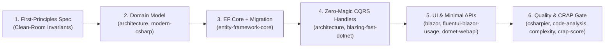
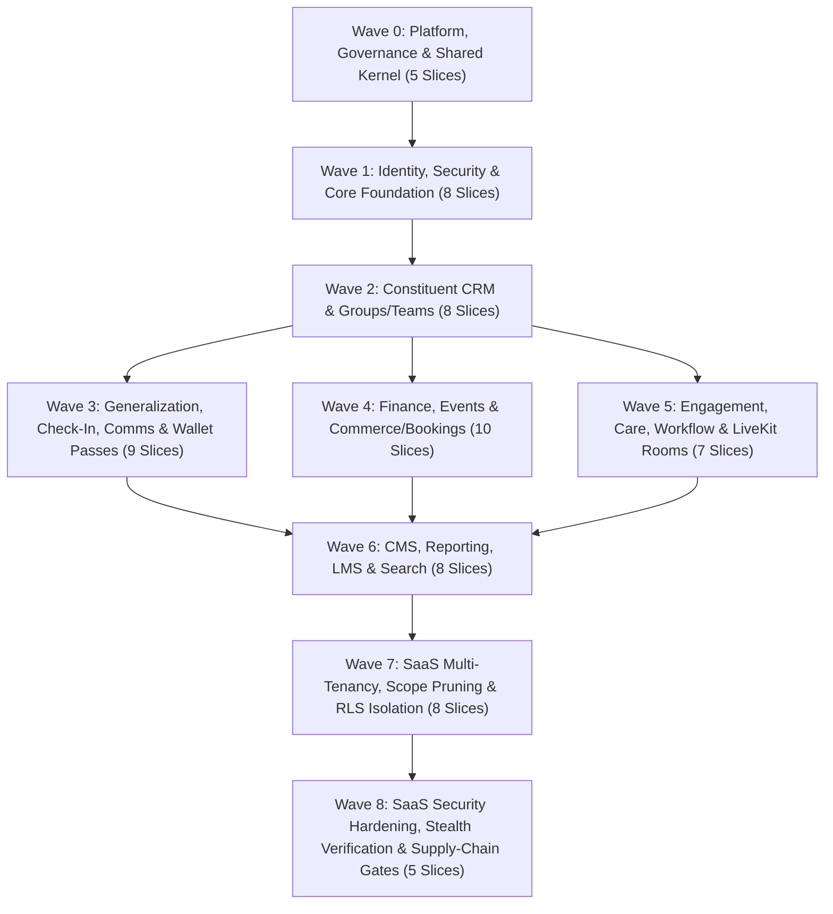

# Ruth — Relationship, Community & Operations Platform Implementation Plan

> **Mission:** Build a clean-room, white-label, high-performance **.NET 10 + Fluent UI Blazor v5 + Domain-Driven Design (DDD)** Multi-Tenant SaaS serving **IRS-recognized tax-exempt organizations** (501(c)(3) charities, foundations, humanitarian, educational, faith-based, and community aid organizations—handling both tax-deductible funds/grants and program fees/invoices/quid-pro-quo splits), backed by **PostgreSQL 18** (`FORCE ROW LEVEL SECURITY`), **Redis 8**, and **RustFS (S3)**.

---

## 1. Locked Architectural Decisions

| # | Decision Area | Locked Choice | Architectural Consequence |
| :--- | :--- | :--- | :--- |
| **1** | **Clean-Room & Tax-Exempt SaaS Posture** | **White-Label Multi-Tenant SaaS for IRS Tax-Exempt Orgs** | Clean PostgreSQL-native DDD schema (`uuidv7` Strongly-Typed IDs, `TenantId` + PostgreSQL 18 `FORCE ROW LEVEL SECURITY` + EF Core Global Query Filters under non-`BYPASSRLS` `ruth_app` role, `timestamptz` / `DateTimeOffset`, `jsonb` + GIN indexes, `postgis`, `pgvector`). Zero code, proprietary heuristics, or schema copying from restrictively licensed ChMS/RMS systems. No public directory and zero tech-stack fingerprinting (`__Host-` host-only cookies, custom domain routing, neutral headers). Self-serve signup provisions an isolated `Sandbox` workspace; going `Live` requires IRS EIN / EO BMF charity verification + mockable Stripe Connect payout readiness + Platform Operator approval. |
| **2** | **UI Paradigm** | **Option A — Hybrid App Shell + CMS Engine** | **Internal Staff Workspace:** Fast, idiomatic Fluent UI Blazor v5 routed pages (`/crm/people/{id}`, `/finance/batches`, `/groups/{id}`, `/admin/core/branches`) served on each organization's own isolated domain.<br>**External / Portals / Custom Pages:** Full database-driven `Site -> Layout -> Page -> Zone -> Block` engine rendered via Blazor `<DynamicComponent>` (`IRuthBlock`).<br>**Platform Operator Console:** Isolated on dedicated internal operator host (`ops.<platform-domain>`). |
| **3** | **Blazor Render Modes & APIs** | **`InteractiveServer` (Staff) + `Static SSR` Islands (CMS) + Minimal APIs** | Staff components invoke Application-layer `ICommandHandler`/`IQueryHandler` in-process with immutable circuit `TenantId` binding. Public CMS uses `Static SSR` + interactive islands. Check-in Kiosk uses a resilient low-latency interactive flow. External/mobile/webhook consumers use ASP.NET Core Minimal APIs + built-in OpenAPI (`AddOpenApi()`). |
| **4** | **CQRS, Messaging & Jobs** | **Zero-Magic Explicit Abstractions** | Custom lightweight `ICommand<T>`, `ICommandHandler<TCommand, T>`, `IQuery<T>`, `IQueryHandler<TQuery, T>`, `IDomainEvent`, `IIntegrationEvent`, `ITenantContext`, and `Result<T>` in `Ruth.SharedKernel` (zero commercial licensing risk from MediatR/MassTransit, zero reflection magic). Per-module tenant-isolated EF Core **Transactional Outbox** + fair-share `BackgroundService` dispatcher + Postgres-backed `IScheduledJob` runner. |
| **5** | **Extensibility Model** | **Modular Assemblies First** | Clean DI-registered strategy contracts (`IPaymentGateway`, `IStripeConnectProvider`, `IIrsCharityVerificationProvider`, `ICommunicationTransport`, `IStorageProvider`, `IFieldTypePlugin`, `IWorkflowAction`, `IBackgroundCheckProvider`, `ISearchDocumentProvider`) compiled as modular assemblies. |
| **6** | **Templating & Rendering** | **Compiled Razor Components (`HtmlRenderer`) + Safe Merge Tokens** | Built-in layouts, transactional emails, annual tax receipts, invoices, and CMS blocks are strongly-typed `.razor` components rendered via Blazor's built-in `HtmlRenderer`. Database-stored, staff-editable content (bulk emails, SMS, waivers, merge fields) uses a safe declarative merge-token engine (`IMergeTemplateEngine` / `TemplateSnippet`) over read-only DTO contexts—eliminating arbitrary runtime scripting/RCE risk. |

---

## 2. Target Solution & Bounded-Context Layout

To satisfy `.agents/skills/architecture` (*"avoid creating extra projects that add ceremony without ownership clarity"*) and `.agents/skills/mcaf` (`MCAF-ARCH-001` canonical vertical-slice identity), each Bounded Context consists of **at most two projects** (`Contracts` + core module containing `Domain`, `Infrastructure`, and `Slices`), with inward dependency rules enforced by `Ruth.ArchitectureTests`.

```text
Ruth.slnx
AGENTS.md                                  # Root repository contract & runnable verification commands
Directory.Build.props                      # net10.0, LangVersion=14, Nullable=enable, TreatWarningsAsErrors=true
Directory.Build.targets
.editorconfig                              # Single source of truth for analyzer severities
CodeMetricsConfig.txt                      # CA1502/CA1505/CA1506 maintainability & complexity thresholds
src/
  Ruth.SharedKernel/                       # AggregateRoot, Entity, ValueObject, StronglyTypedId, Result<T>, IClock, Zero-Magic CQRS & Outbox primitives
  Ruth.Persistence/                        # ModuleDbContext, Transactional Outbox/Inbox, Postgres Advisory-Locked Scheduler
  Ruth.Host/                               # ASP.NET Core 10 + Fluent UI Blazor v5 App Shell, /onboarding, Middleware, Composition Root
  Modules/
    Tenancy/                               # Schema: platform  (Tenants, TenantDomains, IRS Tax-Exempt Verification, Mock/Live Stripe Connect, PlatformOperators)
      Ruth.Modules.Tenancy.Contracts/
      Ruth.Modules.Tenancy/
    Identity/                              # Schema: identity  (Tenant-isolated Users, Logins, OIDC/JWT, SecurityRoles, Hierarchical ISecured ACLs)
      Ruth.Modules.Identity.Contracts/
      Ruth.Modules.Identity/               # Domain/, Infrastructure/, Slices/<SliceName>/
    Core/                                  # Schema: core      (DefinedTypes, Categories, jsonb Attributes/FieldTypes, Branches/Sites, PostGIS Locations, Schedules, BinaryFiles, Audit, Notes, Tags)
    Crm/                                   # Schema: crm       (People/Organizations, Households/Units, Relational Multi-Hop Graph, Merge/Deduplication, Badges, Assessments, Screening)
    Groups/                                # Schema: groups    (GroupTypes, Groups/Chapters/Teams, Memberships, Requirements, Volunteer & Shift Scheduler, Attendance)
    CheckIn/                               # Schema: checkin   (Kiosk & Facility Check-In Config, Household/Member Matching, Capacity Thresholds, ZPL Badges)
    Communication/                         # Schema: comms     (Razor HtmlRenderer + Safe Merge Engine, Transports, Templates, Bulk Email/SMS/Push, Two-Way SMS, Drip Flows)
    Finance/                               # Schema: finance   (Tax-Deductible Funds & Revenue Accounts, Gateways, Batches, Donations/Fees/Invoices, Recurring Billing, Statements/Receipts, Assistance/Grants, Campaigns)
    Events/                                # Schema: events    (Calendars, EventItems, Registrations, Tiered Fees/Discounts/Waitlists, Live Interactive Sessions)
    Commerce/                              # Schema: commerce  (Products/Merch/Digital Goods, Punch/Credit Packs, Member Pricing, Quid-Pro-Quo Splits, 1-on-1 Service Appointments & Facility/Resource Rentals)
    Engagement/                            # Schema: engage    (Engagement Pipelines, Journeys/Milestones, Streaks, Achievements, Care/Support Requests, Reminders, Following, Touchpoints)
    Workflow/                              # Schema: workflow  (WorkflowTypes, State/Activity/Action Engine, Triggers, Interactive Form Builder)
    Cms/                                   # Schema: cms       (Sites, Layouts, Pages, Zones, Dynamic Blocks, Content Channels, Shortlinks, Media, Interactions, Personalization, Mobile/TV)
    Reporting/                             # Schema: reporting (Query AST DataViews, Reports, MergeTemplates, Operational & Financial Metrics, Star-Schema Projections)
    Lms/                                   # Schema: lms       (Programs, Courses, Terms, Classes, Activities, Grading & Certifications)
    Search/                                # Schema: search    (Content Collections, PostgreSQL tsvector + pg_trgm Full-Text Indexing & Spotlight Search)
  Providers/                               # Modular provider assemblies (RustFsStorage, Smtp, SendGrid, Mailgun, Nmi, Stripe, Checkr)
tests/
  Ruth.ArchitectureTests/                  # Enforces module isolation, Domain purity, sealed handlers/DTOs
  Ruth.Modules.<Context>.Tests/            # Unit + Testcontainers (PostgreSQL 18 / Redis 8 / RustFS) slice tests
```

---

## 3. `.agents/skills` Catalog & Non-Overlapping Ownership Matrix

Every skill in `.agents/skills/` has a distinct role. Per `quality-ci`, **overlapping formatters and linters must never fight over the same files**.

### 3.1 Architecture, Backend & UI Authoring Skills

| Skill | Path | Primary Responsibility & Trigger Scope |
| :--- | :--- | :--- |
| **`mcaf`** | [.agents/skills/mcaf/SKILL.md](file:///Users/reginaldchapple/Developer/Ruth/.agents/skills/mcaf/SKILL.md) | Root and per-module `AGENTS.md` governance, canonical slice naming (`MCAF-ARCH-001`), requirement-to-test traceability (`MCAF-REQ-001`), bounded agent delegation (`MCAF-AI-001`). Only invoke when establishing or updating governance contracts. |
| **`architecture`** | [.agents/skills/architecture/SKILL.md](file:///Users/reginaldchapple/Developer/Ruth/.agents/skills/architecture/SKILL.md) | Modular Monolith boundaries, DDD Aggregates/Entities/Value Objects, Domain vs. Integration Events, Zero-Magic CQRS command/query splits, and vertical slice organization without over-abstraction. |
| **`modern-csharp`** | [.agents/skills/modern-csharp/SKILL.md](file:///Users/reginaldchapple/Developer/Ruth/.agents/skills/modern-csharp/SKILL.md) | Idiomatic C# 14 on `.NET 10`: `sealed` classes/records, primary constructors, `readonly record struct` Strongly-Typed IDs, pattern matching, collection expressions, `System.Threading.Lock`. |
| **`aspnet-core`** | [.agents/skills/aspnet-core/SKILL.md](file:///Users/reginaldchapple/Developer/Ruth/.agents/skills/aspnet-core/SKILL.md) | `Ruth.Host` request pipeline & middleware ordering, `IOptions<T>` configuration, cookie/JWT/OIDC authentication, `IAuthorizationHandler` policies, `IHttpClientFactory`, `BackgroundService` workers, health checks. |
| **`dotnet-webapi`** | [.agents/skills/dotnet-webapi/SKILL.md](file:///Users/reginaldchapple/Developer/Ruth/.agents/skills/dotnet-webapi/SKILL.md) | Minimal API resource endpoints (`Map<Resource>`), `sealed record` Request/Response DTOs with XML `<summary>` docs, `DateTimeOffset`, string enums, `TypedResults`, built-in `AddOpenApi()` (never Swashbuckle), RFC 7807 `ProblemDetails`, and `.http` test files. |
| **`entity-framework-core`** | [.agents/skills/entity-framework-core/SKILL.md](file:///Users/reginaldchapple/Developer/Ruth/.agents/skills/entity-framework-core/SKILL.md) | Per-module `DbContext` & PostgreSQL schema isolation, `IEntityTypeConfiguration<T>`, `jsonb`/`postgis`/`pgvector` mappings, `AsNoTracking()` DTO projections, compiled hot queries, concurrency tokens, reviewable migrations. |
| **`blazor`** | [.agents/skills/blazor/SKILL.md](file:///Users/reginaldchapple/Developer/Ruth/.agents/skills/blazor/SKILL.md) | `.NET 10` render modes (`InteractiveServer` for Staff UI, `Static SSR` + islands for CMS), `[PersistentState]`, `<ErrorBoundary>`, `<Virtualize>`, `@key` diffing, debounced search, async `IJSRuntime` interop. |
| **`fluentui-blazor-usage`** | [.agents/skills/fluentui-blazor-usage/SKILL.md](file:///Users/reginaldchapple/Developer/Ruth/.agents/skills/fluentui-blazor-usage/SKILL.md) | `Microsoft.FluentUI.AspNetCore.Components` **v5** patterns: `<FluentProviders />`, JS/CSS custom-property theming, `FluentLayout`/`FluentNav`/`FluentNavCategory`, `FluentDataGrid` (`ItemsProvider`), two-parameter `FluentSelect<TOption, TValue>`, `IDialogService` (`IDialogInstance` cascading parameter). |
| **`blazing-fast-dotnet`** | [.agents/skills/blazing-fast-dotnet/SKILL.md](file:///Users/reginaldchapple/Developer/Ruth/.agents/skills/blazing-fast-dotnet/SKILL.md) | Hot-path engineering: `[LoggerMessage]` source-gen logging, STJ `JsonSerializerContext`, `[GeneratedRegex]`, `FrozenDictionary` caches (ACLs, SystemGuids, FieldTypes), `Span<T>`/`SearchValues`, `StringComparison.Ordinal`, `dotnet-counters`/`dotnet-trace` profiling. |

### 3.2 .NET Quality, Formatting, Static Analysis & Risk Gates

| Skill | Path | Ownership Rule (Non-Overlapping) |
| :--- | :--- | :--- |
| **`quality-ci`** | [.agents/skills/quality-ci/SKILL.md](file:///Users/reginaldchapple/Developer/Ruth/.agents/skills/quality-ci/SKILL.md) | Orchestrates the single canonical CI & post-slice verification pass (format -> build/analyze -> tests -> architecture -> coverage). |
| **`csharpier`** | [.agents/skills/csharpier/SKILL.md](file:///Users/reginaldchapple/Developer/Ruth/.agents/skills/csharpier/SKILL.md) | **Exclusive whitespace & layout owner** for `.cs`, `.csproj`, `.props`, `.targets`, and `.slnx` via `dotnet csharpier check .`. |
| **`format`** | [.agents/skills/format/SKILL.md](file:///Users/reginaldchapple/Developer/Ruth/.agents/skills/format/SKILL.md) | Scoped **strictly to `dotnet format style` and `dotnet format analyzers` (`--verify-no-changes`)**—never `whitespace`, so it never conflicts with `csharpier`. |
| **`code-analysis`** | [.agents/skills/code-analysis/SKILL.md](file:///Users/reginaldchapple/Developer/Ruth/.agents/skills/code-analysis/SKILL.md) | First-party .NET 10 SDK analyzers (`EnableNETAnalyzers=true`, `AnalysisLevel=latest-recommended`, `TreatWarningsAsErrors=true`, Security `CA3xxx`/`CA5xxx = error`). Agents must **never** weaken warning gates. |
| **`analyzer-config`** | [.agents/skills/analyzer-config/SKILL.md](file:///Users/reginaldchapple/Developer/Ruth/.agents/skills/analyzer-config/SKILL.md) | Owns the repo-root `.editorconfig` rule severity layout (`root = true`, no inline comments). |
| **`meziantou-analyzer`** | [.agents/skills/meziantou-analyzer/SKILL.md](file:///Users/reginaldchapple/Developer/Ruth/.agents/skills/meziantou-analyzer/SKILL.md) | **Primary third-party Roslyn analyzer pack** (`Meziantou.Analyzer`) catching async/CancellationToken misuse, culture-unsafe string ops, concurrency bugs, and security issues. |
| **`complexity`** | [.agents/skills/complexity/SKILL.md](file:///Users/reginaldchapple/Developer/Ruth/.agents/skills/complexity/SKILL.md) | Enforces `CA1502` (cyclomatic complexity), `CA1505` (maintainability), `CA1506` (class coupling), and `CA1501` via checked-in `CodeMetricsConfig.txt`. |
| **`crap-score`** | [.agents/skills/crap-score/SKILL.md](file:///Users/reginaldchapple/Developer/Ruth/.agents/skills/crap-score/SKILL.md) | Evaluates Change Risk Anti-Patterns (`CRAP < 15` target, never `> 30`) using real Cobertura coverage on complex domain services/engines (ACLs, Merge, Check-In, Template/Merge Engine, DataViews, Batches/Fees, Workflows). |
| **`roslynator`** | [.agents/skills/roslynator/SKILL.md](file:///Users/reginaldchapple/Developer/Ruth/.agents/skills/roslynator/SKILL.md) | **On-demand CLI cleanup & dead-code audit** (`roslynator find-unused`) at the end of each Wave; not stacked as duplicate build errors over SDK + Meziantou. |
| **`stylecop-analyzers`** | [.agents/skills/stylecop-analyzers/SKILL.md](file:///Users/reginaldchapple/Developer/Ruth/.agents/skills/stylecop-analyzers/SKILL.md) | **Scoped opt-in only** if public `Contracts`/API DTO XML documentation rules (`SA1600`) are desired; layout rules stay disabled so `csharpier` remains sole layout owner. |

### 3.3 Frontend Asset, Stylesheet & Runtime Browser Audit Skills

| Skill | Path | Ownership Rule (Non-Overlapping) |
| :--- | :--- | :--- |
| **`biome`** | [.agents/skills/biome/SKILL.md](file:///Users/reginaldchapple/Developer/Ruth/.agents/skills/biome/SKILL.md) | **Primary formatter & linter** (`biome.json`) for Blazor JS/TS interop modules (`wwwroot/**/*.js`, `*.ts`) and static JSON assets. |
| **`stylelint`** | [.agents/skills/stylelint/SKILL.md](file:///Users/reginaldchapple/Developer/Ruth/.agents/skills/stylelint/SKILL.md) | **Stylesheet owner** for custom CSS (`wwwroot/**/*.css`, `.razor.css` isolation styles, Fluent v5 token usage, and CMS themes). |
| **`htmlhint`** | [.agents/skills/htmlhint/SKILL.md](file:///Users/reginaldchapple/Developer/Ruth/.agents/skills/htmlhint/SKILL.md) | Validates **rendered/static HTML output** (exported Email HTML templates, Tax Receipt / Invoice HTML, and rendered CMS pages)—never raw `.razor` source files. |
| **`webhint`** | [.agents/skills/webhint/SKILL.md](file:///Users/reginaldchapple/Developer/Ruth/.agents/skills/webhint/SKILL.md) | **Runtime URL auditor** (`.hintrc`) checking accessibility (a11y), security headers, performance, PWA signals, and SEO against live `/onboarding`, Staff Shell, Check-in Kiosk, and Public CMS routes. |
| **`eslint`** | [.agents/skills/eslint/SKILL.md](file:///Users/reginaldchapple/Developer/Ruth/.agents/skills/eslint/SKILL.md) | Standby (`not_applicable` by default while `biome` owns JS/TS); activate **only** on bounded rich client packages (e.g., visual Form/Workflow canvas) if specialized ESLint plugins are required. |
| **`sonarjs`** | [.agents/skills/sonarjs/SKILL.md](file:///Users/reginaldchapple/Developer/Ruth/.agents/skills/sonarjs/SKILL.md) | Cognitive-complexity extension (`eslint-plugin-sonarjs`) paired with `eslint` **only** if complex client-side TypeScript editors (ZPL label canvas / Workflow designer) are introduced. |

### 3.4 Security Hardening & Supply-Chain Verification Skills

Only security skills matching `Ruth`'s `.NET 10` / Blazor / PostgreSQL / Docker / GitHub Actions stack are retained in `.agents/skills/` (alongside the 25 core engineering/quality skills above).

| Capability Area | Retained Skills (`.agents/skills/<skill>/SKILL.md`) | Primary Responsibility in `Ruth` |
| :--- | :--- | :--- |
| **Outbound SSRF & Webhooks** | `exploiting-server-side-request-forgery`, `performing-ssrf-vulnerability-exploitation` | Private/loopback/metadata IP deny-lists on `SocketsHttpHandler`, redirect blocking, and signed webhook replay protection. |
| **Headers, CSRF/CORS & Rate Limiting** | `performing-security-headers-audit`, `testing-for-host-header-injection`, `implementing-api-rate-limiting-and-throttling`, `performing-clickjacking-attack-test`, `performing-csrf-attack-simulation`, `testing-cors-misconfiguration` | `CSP`, `Permissions-Policy`, `HSTS`, antiforgery/CORS boundaries, trusted proxy `ForwardedHeaders`, `AllowedHosts`, and tiered endpoint rate limits. |
| **Auth, OIDC/JWT, API ACLs & Logic** | `testing-jwt-token-security`, `implementing-jwt-signing-and-verification`, `testing-oauth2-implementation-flaws`, `testing-for-open-redirect-vulnerabilities`, `implementing-api-key-security-controls`, `testing-api-security-with-owasp-top-10`, `testing-api-for-broken-object-level-authorization`, `testing-for-broken-access-control`, `testing-api-for-mass-assignment-vulnerability`, `testing-websocket-api-security`, `exploiting-race-condition-vulnerabilities`, `testing-for-business-logic-vulnerabilities` | Algorithm-pinned JWTs, refresh-token reuse revocation, PKCE/nonce OIDC, hashed `RestApiKey`s, SignalR/LiveKit auth, concurrency/seat-hold safety, and cross-module `ISecured` BOLA/IDOR verification. |
| **Crypto, Storage, Injection & Comms** | `performing-cryptographic-audit-of-application`, `implementing-aes-encryption-for-data-at-rest`, `testing-for-sensitive-data-exposure`, `auditing-aws-s3-bucket-permissions`, `performing-directory-traversal-testing`, `testing-for-xss-vulnerabilities`, `testing-for-email-header-injection`, `exploiting-sql-injection-vulnerabilities`, `exploiting-insecure-deserialization`, `implementing-dmarc-dkim-spf-email-security` | Envelope encryption for DB-stored provider secrets, `RustFS` S3 upload MIME/SVG isolation, CMS/Search/SQL/deserialization guards, and Email XSS/CRLF + SPF/DKIM/DMARC guidance. |
| **Containers, CI, Supply Chain & Trust** | `hardening-docker-containers-for-production`, `performing-container-image-hardening`, `securing-github-actions-workflows`, `implementing-secrets-scanning-in-ci-cd`, `scanning-containers-with-trivy-in-cicd`, `integrating-sast-into-github-actions-pipeline`, `generating-and-analyzing-sboms`, `implementing-immutable-backup-with-restic`, `implementing-pci-dss-compliance-controls`, `performing-soc2-type2-audit-preparation` | Non-root chiseled containers, loopback/internal Compose networking, SHA-pinned GitHub Actions, `gitleaks`, `Trivy`, CycloneDX SBOMs, backup runbooks, and PCI/SOC2 trust alignment. |

---

## 4. Standard Slice Execution Contract ("Clean-Room & Shippable")

Every slice (`W<Wave>-S<Slice>`) is an atomic, shippable vertical increment. **Never start N+1 infrastructure for a future wave inside an earlier slice.**



### Definition of Done (Every Slice)
1. **Clean-Room Specification:** Define domain invariants, edge cases, and open-standard workflows from first principles—never referencing or copying restrictively licensed third-party code or proprietary formulas.
2. **Domain Purity:** Aggregates enforce invariants via methods returning `Result<T>`, emit `IDomainEvent`s, use `Guid.CreateVersion7()` Strongly-Typed IDs, remain organization-agnostic, and have **zero** dependencies on EF Core, ASP.NET Core, or Blazor.
3. **Persistence:** Module-scoped `DbContext` + explicit `IEntityTypeConfiguration<T>` + reviewable EF Core migration + `AsNoTracking()` read projections.
4. **Presentation:** Fluent UI Blazor v5 pages/dialogs (with `<ErrorBoundary>`, loading states, and ACL checks) and/or Minimal API endpoints (`TypedResults` + OpenAPI metadata + `.http` requests).
5. **Automated Tests:** Domain unit tests + Testcontainers PostgreSQL 18 integration tests + `Ruth.ArchitectureTests` green.
6. **Post-Slice Quality Gate:**
   - `dotnet tool run csharpier check .` (`csharpier`)
   - `dotnet build Ruth.slnx -warnaserror` (`code-analysis`, `meziantou-analyzer`, `complexity`)
   - `dotnet format style Ruth.slnx --verify-no-changes && dotnet format analyzers Ruth.slnx --verify-no-changes` (`format`)
   - `dotnet test` with Cobertura coverage + `crap-score` check (`CRAP < 15`) on newly added complex domain methods.

---

## 5. Wave Dependency Roadmap



> [!TIP]
> With **Wave 2** and **`W3-S0` (Clean-Room & Organization-Agnostic Generalization)** complete, **Waves 3, 4, and 5** depend primarily on `Identity`, `Core`, `Crm.Contracts`, and `Groups.Contracts`—meaning slices across Check-In/Comms, Finance/Events, and Engagement/Workflow can be executed **in parallel** (e.g., via `/teamwork` swarm workers in isolated workspaces).

---

## 6. Detailed Wave & Vertical Slice Catalog

### Wave 0 — Platform, Governance & Shared Kernel
*Goal: Establish repository governance, zero-warning CI gates, DDD/CQRS building blocks, Docker infrastructure, and the Fluent UI v5 host shell with zero-seed `/onboarding`.*

#### `W0-S1` — Repository Governance, Solution Skeleton & Quality Gates ✅ *(Completed)*
* **Scope:** Configure root `AGENTS.md`, `Ruth.slnx`, `Directory.Build.props` (`net10.0`, `LangVersion=14`, `TreatWarningsAsErrors=true`, `EnableNETAnalyzers=true`, `Meziantou.Analyzer`), repo-root `.editorconfig`, `CodeMetricsConfig.txt`, local `csharpier` tool manifest, `biome.json`, `stylelint.config.mjs`, Docker stack ([Dockerfile](file:///Users/reginaldchapple/Developer/Ruth/deploy/docker/dotnet/Dockerfile), `docker-compose.yml`), and `tests/Ruth.ArchitectureTests`.
* **Authoring Skills:** `mcaf`, `architecture`, `quality-ci`, `analyzer-config`, `code-analysis`, `meziantou-analyzer`, `complexity`, `csharpier`, `biome`, `stylelint`.
* **Verification Skills:** `quality-ci`, `csharpier`, `format`, `code-analysis`.

#### `W0-S2` — `Ruth.SharedKernel` (DDD & Zero-Magic CQRS Primitives) ✅ *(Completed)*
* **Scope:** `Entity<TId>`, `AggregateRoot<TId>`, `IStronglyTypedId<T>` (`Guid.CreateVersion7()`), `ValueObject`, `Result` / `Result<T>` / `Error`, `IClock` (`TimeProvider` adapter), `IDomainEvent` / `IDomainEventHandler<T>`, `IIntegrationEvent` / `IIntegrationEventHandler<T>`, explicit DI-dispatched `ICommand<TResponse>` / `ICommandHandler<TCommand, TResponse>` and `IQuery<TResponse>` / `IQueryHandler<TQuery, TResponse>` with logging/validation decorator pipeline.
* **Authoring Skills:** `architecture`, `modern-csharp`, `blazing-fast-dotnet`.
* **Verification Skills:** `csharpier`, `code-analysis`, `complexity`, `crap-score`.

#### `W0-S3` — Module Persistence Base, Transactional Outbox & Scheduled Job Engine ✅ *(Completed)*
* **Scope:** Abstract `ModuleDbContext` (Npgsql 18 with `postgis`, `pgvector`, `age` readiness), audit timestamp/concurrency `SaveChangesInterceptor`, per-schema `OutboxMessage` + `InboxMessage` tables, `BackgroundService` Outbox dispatcher, and Postgres-advisory-locked cron `IScheduledJob` engine.
* **Authoring Skills:** `entity-framework-core`, `architecture`, `aspnet-core`, `modern-csharp`, `blazing-fast-dotnet`.
* **Verification Skills:** `csharpier`, `code-analysis`, `complexity`, `crap-score`.

#### `W0-S4` — `Ruth.Host` Pipeline, Observability & Fluent UI Blazor v5 App Shell ✅ *(Completed)*
* **Scope:** `Program.cs` middleware pipeline (`ApiExceptionHandler` -> HTTPS -> `MapStaticAssets` -> Routing -> Auth -> RateLimiter -> OutputCache -> Endpoints), built-in `AddOpenApi()`, `/health` checks (Postgres, Redis, RustFS), OpenTelemetry logging/metrics/tracing, `<FluentProviders />`, `MainLayout.razor` (`FluentLayout`, `FluentNav`, light/dark theme toggle via `Blazor.theme`, `<ErrorBoundary>`).
* **Authoring Skills:** `aspnet-core`, `blazor`, `fluentui-blazor-usage`, `dotnet-webapi`, `stylelint`, `biome`.
* **Verification Skills:** `csharpier`, `code-analysis`, `webhint` (against local host shell).

#### `W0-S5` — Zero-Seed First-Run `/onboarding` & Production Startup Guards ✅ *(Completed)*
* **Scope:** Production fail-fast validator if `Authentication:Jwt:SigningKey` uses dev default; onboarding state gate middleware redirecting all routes to `/onboarding` when zero admin users exist; one-time Administrator + Organization & Primary Branch/Site setup wizard that permanently locks self-registration upon completion (matching [.env.example](file:///Users/reginaldchapple/Developer/Ruth/.env.example)).
* **Authoring Skills:** `aspnet-core`, `blazor`, `fluentui-blazor-usage`, `entity-framework-core`, `modern-csharp`.
* **Verification Skills:** `csharpier`, `code-analysis`, `webhint`, `crap-score`.

---

### Wave 1 — Identity, Security & Core Foundation
*Goal: Deliver enterprise authentication, hierarchical Allow/Deny entity security, extensible `jsonb` attributes/FieldTypes, Branches/Sites, PostGIS locations, iCal schedules, and RustFS storage.*

#### `W1-S1` — Authentication, User Logins & OIDC/JWT Providers ✅ *(Completed)*
* **Scope:** `Identity` module (`identity` schema): `UserAccount`, Argon2id/ASP.NET Core password hashing, Cookie auth for Blazor Server, JWT Bearer + Refresh Tokens for APIs/Mobile, external OIDC provider abstraction, password reset & account confirmation flows, login history, `Auth.http`.
* **Authoring Skills:** `aspnet-core`, `architecture`, `entity-framework-core`, `dotnet-webapi`, `blazor`, `fluentui-blazor-usage`, `modern-csharp`.
* **Verification Skills:** `csharpier`, `code-analysis`, `complexity`, `crap-score`.

#### `W1-S2` — Security Roles & Hierarchical `ISecured` ACL Engine ✅ *(Completed)*
* **Scope:** `SecurityRole`, special roles (`AllUsers`, `AllAuthenticatedUsers`), `EntityAclRule` (ordered `Allow`/`Deny` per action `View`, `Edit`, `Administrate`, etc. with parent-entity hierarchy inheritance), `AuthAuditLog`, `RestApiKey`, `AuthClient`/`AuthScope`, Redis-backed `FrozenDictionary` ACL evaluator + ASP.NET Core `IAuthorizationHandler` + reusable Blazor `<SecurityDialog />`.
* **Authoring Skills:** `architecture`, `aspnet-core`, `blazing-fast-dotnet`, `entity-framework-core`, `fluentui-blazor-usage`, `blazor`.
* **Verification Skills:** `csharpier`, `code-analysis`, `complexity`, `crap-score`.

#### `W1-S3` — Entity Registry, DefinedTypes & Hierarchical Categories ✅ *(Completed)*
* **Scope:** `Core` module (`core` schema): `EntityTypeDescriptor` (compile-time discovered modular entity registry + `SystemGuid` constants), `DefinedType` + `DefinedValue` aggregate, recursive `Category` tree aggregate, Redis/memory read caches, Admin UI screens (`DefinedTypeList`, `DefinedTypeDetail`, `CategoryTreeView`).
* **Authoring Skills:** `architecture`, `entity-framework-core`, `blazor`, `fluentui-blazor-usage`, `blazing-fast-dotnet`.
* **Verification Skills:** `csharpier`, `code-analysis`, `complexity`.

#### `W1-S4` — Typed `jsonb` Attribute Engine, Attribute Matrices & Core FieldTypes ✅ *(Completed)*
* **Scope:** `AttributeDefinition` (global, entity-type, or entity-qualifier scoped), `AttributeMatrixTemplate` (repeatable structured sub-rows in `jsonb`), `IHasAttributes` `jsonb` column convention + GIN index helper, and modular `IFieldTypePlugin` registry (25 foundational FieldTypes: Text, Memo, Boolean, Integer, Decimal, Currency, Date, DateTime, DateRange, SingleSelect, MultiSelect, DefinedValue, Category, KeyValueList, Json/Code, Color, Url, Email, Phone, Rating, Matrix) + dynamic `<AttributeValuesEditor />` and `<AttributeValuesSummary />` Blazor components.
* **Authoring Skills:** `architecture`, `entity-framework-core`, `blazor`, `fluentui-blazor-usage`, `modern-csharp`, `blazing-fast-dotnet`.
* **Verification Skills:** `csharpier`, `code-analysis`, `complexity`, `crap-score`.

#### `W1-S5` — Branches (Sites), PostGIS Locations & Physical Devices ✅ *(Completed — Generalized in `W3-S0`)*
* **Scope:** `Branch` (`BranchSchedule`, `BranchTopic` — representing operating Sites, Branches, Chapters, Centers, or Offices), `Location` hierarchy (buildings, rooms, named locations, street addresses) with `NetTopologySuite` **PostGIS** `geography(Point, 4326)` & `geography(Polygon, 4326)` geofences, `IAddressVerificationProvider` / geocoding hook, `Device` (kiosks, label printers, check-in tablets, IP/Geo matching).
* **Authoring Skills:** `architecture`, `entity-framework-core`, `blazor`, `fluentui-blazor-usage`, `dotnet-webapi`.
* **Verification Skills:** `csharpier`, `code-analysis`, `complexity`.

#### `W1-S6` — Schedules & iCalendar Recurrence Engine ✅ *(Completed)*
* **Scope:** `Schedule` aggregate (`iCalendarContent` RFC 5545 RRULEs, check-in start/end offsets, `ScheduleDate` materialized horizon table for fast SQL range joins, `ScheduleCategoryExclusion`), friendly schedule text formatter, `<ScheduleBuilderDialog />` Blazor component.
* **Authoring Skills:** `architecture`, `modern-csharp`, `entity-framework-core`, `blazor`, `fluentui-blazor-usage`, `blazing-fast-dotnet`.
* **Verification Skills:** `csharpier`, `code-analysis`, `complexity`, `crap-score`.

#### `W1-S7` — BinaryFiles, Documents, Electronic Signatures & RustFS Storage ✅ *(Completed)*
* **Scope:** `IStorageProvider` + `RustFsStorageProvider` (S3 presigned URLs & streaming uploads), `BinaryFileType`, `BinaryFile`, image crop/avatar processor, `DocumentType`/`Document`, `SignatureDocumentTemplate`/`SignatureDocument` electronic signature capture, `<FileUploader />` & `<ImageEditor />` Blazor components.
* **Authoring Skills:** `architecture`, `aspnet-core`, `entity-framework-core`, `dotnet-webapi`, `blazor`, `fluentui-blazor-usage`.
* **Verification Skills:** `csharpier`, `code-analysis`, `complexity`.

#### `W1-S8` — Audit History, Notes, Tags, EntitySets & User Preferences ✅ *(Completed)*
* **Scope:** Structured `HistoryLog` (`HistoryLogEntry` domain change timeline), `NoteType`/`Note`/`NoteAttachment`/`NoteWatch` threaded notes timeline component, personal & organizational `Tag`/`TaggedItem` autocomplete pill bar, ephemeral/saved `EntitySet` bulk selection sets, `PersonPreference` key-value store.
* **Authoring Skills:** `architecture`, `entity-framework-core`, `blazor`, `fluentui-blazor-usage`, `modern-csharp`.
* **Verification Skills:** `csharpier`, `code-analysis`, `complexity`.

---

### Wave 2 — Constituent CRM & Groups/Teams
*Goal: Deliver complete Person & Organization 360 profiles, Household/Unit & Apache AGE relationship graphs, deduplication/merge, hierarchical groups/chapters/teams, volunteer/shift scheduling, and attendance.*

#### `W2-S1` — Person Aggregate, Contact Info, Metaphones & Fast Person Search ✅ *(Completed)*
* **Scope:** `Crm` module (`crm` schema): `Person` aggregate (record type Person/Business/SystemUser, connection status, record status, marital status, BirthDate, graduation/grade calculation, deceased handling, photo, `PrimaryBranchId`), `PhoneNumber` (E.164 normalization, SMS opt-in), `PersonPreviousName`, `PersonSearchKey` (alternate emails/barcodes/external IDs), `Metaphone` / `MetaFirstNameGenderLookup` / `MetaNickNameLookup`, PostgreSQL `pg_trgm` + phonetic instant search bar & Person Profile header.
* **Authoring Skills:** `architecture`, `modern-csharp`, `entity-framework-core`, `blazor`, `fluentui-blazor-usage`, `blazing-fast-dotnet`.
* **Verification Skills:** `csharpier`, `code-analysis`, `complexity`, `crap-score`.

#### `W2-S2` — Households (Member/Billing Units) & Apache AGE Relationship Graph ✅ *(Completed — Generalized in `W3-S0`)*
* **Scope:** First-class `Household` aggregate (Adult/Child roles, `IsPrimaryContact`, `BranchId`, Mapped Mailing/Home `Location`s, Combined Contribution/Billing Unit flag, multi-household membership) + `KnownRelationship` & `PeerNetwork` graph (clean-room bounded saturation growth & exponential half-life decay) synchronized to **PostgreSQL Apache AGE** (`crm_graph`) for multi-hop relationship traversal, plus Household UI cards on Person Profile.
* **Authoring Skills:** `architecture`, `entity-framework-core`, `blazor`, `fluentui-blazor-usage`, `modern-csharp`.
* **Verification Skills:** `csharpier`, `code-analysis`, `complexity`, `crap-score`.

#### `W2-S3` — Person Duplicate Detection, Redirect Ledger & Cross-Module Merge ✅ *(Completed — Generalized in `W3-S0`)*
* **Scope:** Scheduled `PersonDuplicateScannerJob` (clean-room completeness-adjusted weighted attribute similarity scoring across email/phones/address/name/DOB/suffix), `PersonRedirect` ledger (maps retired `PersonId`s and optional `ExternalRecordGuid`s to surviving `PersonId`), side-by-side Blazor `<PersonMergePage />`, and `PersonMergedIntegrationEvent` via Outbox so every downstream module (`Core`, `Groups`, `Finance`, `CheckIn`, etc.) re-points `PersonId` cleanly.
* **Authoring Skills:** `architecture`, `entity-framework-core`, `blazor`, `fluentui-blazor-usage`, `blazing-fast-dotnet`.
* **Verification Skills:** `csharpier`, `code-analysis`, `complexity`, `crap-score`.

#### `W2-S4` — Signals, Extensible Badges, Assessments & Background Screening ✅ *(Completed — Generalized in `W3-S0`)*
* **Scope:** `SignalType` / `PersonSignal` (top-of-profile safety/compliance/VIP banners), modular `IPersonBadge` Blazor component bar, `AssessmentType` / `Assessment` (Team Strengths, DISC, Conflict Style, Motivators, Emotional Intelligence), `BackgroundCheck` + `IBackgroundCheckProvider` (including modular Checkr webhook adapter), `IdentityVerification`, and `PersonViewed` audit log.
* **Authoring Skills:** `architecture`, `aspnet-core`, `dotnet-webapi`, `entity-framework-core`, `blazor`, `fluentui-blazor-usage`.
* **Verification Skills:** `csharpier`, `code-analysis`, `complexity`.

#### `W2-S5` — GroupTypes, Group Hierarchy, Locations & PostGIS Group Finder ✅ *(Completed — Generalized in `W3-S0`)*
* **Scope:** `Groups` module (`groups` schema): `GroupType` (`GroupTypeRole`, allowed child GroupTypes, `GroupsRequireBranch`, location modes, attendance rules), `Group` tree aggregate (chapters, committees, cohorts, classes, volunteer teams), `GroupLocation`, `GroupDemographicType`/`Value`, `GroupHistorical` snapshots, Admin `GroupTreeView`/`GroupDetail` shell, and public/internal PostGIS radius/polygon `GroupFinder` + map view.
* **Authoring Skills:** `architecture`, `entity-framework-core`, `blazor`, `fluentui-blazor-usage`, `modern-csharp`.
* **Verification Skills:** `csharpier`, `code-analysis`, `complexity`.

#### `W2-S6` — Group Memberships, Requirements, Placement & Sync ✅ *(Completed)*
* **Scope:** `GroupMember` lifecycle (Active, Inactive, Pending, capacity/role limits, `GroupMemberHistorical`), `GroupRequirementType` / `GroupRequirement` / `GroupMemberRequirement` (background screening/certification/attribute prerequisites), `GroupPlacement` board, `GroupSimpleRegister`, and scheduled `GroupSync` reconciliation.
* **Authoring Skills:** `architecture`, `entity-framework-core`, `blazor`, `fluentui-blazor-usage`, `modern-csharp`.
* **Verification Skills:** `csharpier`, `code-analysis`, `complexity`, `crap-score`.

#### `W2-S7` — Volunteer & Shift Roster Scheduler & RSVPs ✅ *(Completed — Generalized in `W3-S0`)*
* **Scope:** `GroupMemberScheduleTemplate`, `GroupLocationScheduleConfig` (min/desired/max staffing thresholds), `GroupMemberAssignment`, `PersonScheduleExclusion` (blackout dates), `GroupScheduleExclusion`, interactive Coordinator Roster Grid + Volunteer/Staff Schedule Toolbox & Decline/Accept RSVP links (`Rsvp`).
* **Authoring Skills:** `architecture`, `entity-framework-core`, `blazor`, `fluentui-blazor-usage`, `modern-csharp`.
* **Verification Skills:** `csharpier`, `code-analysis`, `complexity`, `crap-score`.

#### `W2-S8` — Attendance Occurrences & Roster Checklists ✅ *(Completed — Generalized in `W3-S0`)*
* **Scope:** `AttendanceOccurrence` (Group + Location + Schedule + OccurrenceDate, configurable `WeekEndDate` via `ReportingWeekCalculator`, `DidNotOccur`), `Attendance` records (`BranchId`), mobile/tablet-friendly Roster Attendance checklist UI, Branch/Program metric summary hooks, and `PersonAttendedIntegrationEvent`.
* **Authoring Skills:** `architecture`, `entity-framework-core`, `blazor`, `fluentui-blazor-usage`, `dotnet-webapi`.
* **Verification Skills:** `csharpier`, `code-analysis`, `complexity`.

---

### Wave 3 — Clean-Room Generalization, Check-In & Communications
*Goal: Complete the organization-agnostic clean-room refactor, then deliver mission-critical Kiosk/Facility Check-In, ZPL badge printing, the Razor & safe merge-token template engine, and multi-channel communications.*

#### `W3-S0` — Clean-Room & Organization-Agnostic Generalization ✅ *(Completed)*
* **Scope:** Disconnect external ChMS reference code (`refs/`); generalize `Campus` -> `Branch` (`Site`/`Branch`) across `Identity`, `Core`, `Crm`, `Groups`, and `Host` with EF Core schema migrations (dropping church-only `TitheMetric` and `AverageWeekendAttendance`); replace `SundayDateCalculator` with configurable `ReportingWeekCalculator` (`WeekEndDate`); replace legacy-derived CRM heuristics (`PersonDuplicateScorer`, `HouseholdDomainService`, `PeerNetworkScoreCalculator`, `PersonRedirect`, `CronExpression`) with clean-room, gender-neutral, first-principles implementations; neutralize seeded assessments, screening packages, and UI copy.
* **Authoring Skills:** `mcaf`, `architecture`, `modern-csharp`, `entity-framework-core`, `blazor`, `fluentui-blazor-usage`.
* **Verification Skills:** `quality-ci`, `csharpier`, `format`, `code-analysis`, `complexity`, `crap-score`.

#### `W3-S1` — Razor Template Renderer, Safe Merge Tokens & Reusable Snippets ✅ *(Completed)*
* **Scope:** `IRazorTemplateRenderer` built on Blazor's native `.NET 10` `HtmlRenderer` (rendering strongly-typed `.razor` component templates to HTML/text with DI support) paired with `IMergeTemplateEngine` for database-stored, staff-editable content (emails, SMS, signature waivers, ZPL/text): compiled token parser (`{{ Field }}` with safe built-in formatters for dates, currency, casing, fallback defaults, and HTML encoding), strict size/recursion limits, reusable `TemplateSnippet` definitions, and read-only DTO merge contexts.
* **Authoring Skills:** `architecture`, `modern-csharp`, `blazing-fast-dotnet`, `blazor`, `fluentui-blazor-usage`.
* **Verification Skills:** `csharpier`, `code-analysis`, `complexity`, `crap-score`.

#### `W3-S2` — Check-In Configuration, Areas, Eligibility Rules & Room Balancing ✅ *(Completed)*
* **Scope:** `CheckIn` module (`checkin` schema): Check-in configuration profiles (youth/childcare safety, member facility access, classes, volunteer shifts, conferences), Area/Group/Location/Schedule matrices, eligibility specifications (Age range, Birthdate, Grade, Membership/Skill tier, Accessibility/Accommodations, Pre-Enrolled), room capacity thresholds, and automated room-balancing domain service.
* **Authoring Skills:** `architecture`, `modern-csharp`, `entity-framework-core`, `blazor`, `fluentui-blazor-usage`, `blazing-fast-dotnet`.
* **Verification Skills:** `csharpier`, `code-analysis`, `complexity`, `crap-score`.

#### `W3-S3` — High-Throughput Check-In Session Engine, Kiosk UI & Room/Facility Manager ✅ *(Completed)*
* **Scope:** `AttendanceCheckInSession`, collision-free daily `SecurityPickupCode` generator (configurable alpha/numeric pickup/badge codes with profanity filter), sub-50ms phone-number/household/member-card/barcode search, touch-optimized Blazor Check-In Kiosk UI + Check-Out flow + live Room/Facility Manager roster/override tablet UI + Mobile Check-In Minimal APIs.
* **Authoring Skills:** `architecture`, `blazing-fast-dotnet`, `entity-framework-core`, `blazor`, `fluentui-blazor-usage`, `dotnet-webapi`, `stylelint`.
* **Verification Skills:** `csharpier`, `code-analysis`, `complexity`, `crap-score`, `webhint` (Kiosk touch/a11y/perf audit).

#### `W3-S4` — Badge & Label Designer & Zebra ZPL Print Pipeline ✅ *(Completed)*
* **Scope:** `CheckInLabel` aggregate (JSON layout schema + Zebra ZPL compilation), merge fields (Pickup Security Code, Medical/Allergy/Compliance Alerts, Room/Zone, Guardian Receipt, Badge/Tier icons), server TCP raw-socket printer dispatch (for local/VPN Zebra printers) + browser local-print/WebUSB JS interop module, and visual Blazor Label Preview/Editor.
* **Authoring Skills:** `architecture`, `modern-csharp`, `blazing-fast-dotnet`, `blazor`, `fluentui-blazor-usage`, `biome`.
* **Verification Skills:** `csharpier`, `code-analysis`, `biome`, `complexity`, `crap-score`.

#### `W3-S5` — Communication Transports, System Notifications & Snippets ✅ *(Completed)*
* **Scope:** `Communication` module (`comms` schema): `ICommunicationTransport` modular contracts + providers (SMTP, SendGrid, Mailgun, Twilio SMS, Push Notification stub, Dev In-Memory Sink), `SystemCommunication` transactional email/SMS templates (wired to Identity/Group/Finance/Workflow events), `SystemPhoneNumber`, `PersonalDevice` push tokens.
* **Authoring Skills:** `architecture`, `aspnet-core`, `entity-framework-core`, `blazor`, `fluentui-blazor-usage`, `htmlhint`.
* **Verification Skills:** `csharpier`, `code-analysis`, `htmlhint`, `complexity`.

#### `W3-S6` — Bulk Communications, Email Builder, Recipients & Two-Way SMS Pipeline ✅ *(Completed)*
* **Scope:** `CommunicationTemplate`, `EmailSection` structured email composer, `Communication` lifecycle (Draft -> Pending Approval -> Approved -> Sending -> Sent), `CommunicationRecipient` batch sending job, bounce/open/click webhook Minimal APIs, unsubscribe/preference center management, two-way SMS Conversations inbox (`CommunicationResponse`) + `SmsPipeline`/`SmsAction` keyword responder.
* **Authoring Skills:** `architecture`, `aspnet-core`, `dotnet-webapi`, `entity-framework-core`, `blazor`, `fluentui-blazor-usage`, `htmlhint`, `stylelint`.
* **Verification Skills:** `csharpier`, `code-analysis`, `htmlhint`, `complexity`, `crap-score`.

#### `W3-S7` — Communication Flows & Automated Drip Campaigns ✅ *(Completed)*
* **Scope:** `CommunicationFlow` (multi-step timed onboarding/renewal/engagement drip sequences, exit/conversion conditions), `CommunicationFlowInstance`, `CommunicationFlowInstanceRecipient`, `CommunicationFlowConversion`, Flow Builder & Performance Analytics UI.
* **Authoring Skills:** `architecture`, `entity-framework-core`, `blazor`, `fluentui-blazor-usage`, `modern-csharp`.
* **Verification Skills:** `csharpier`, `code-analysis`, `complexity`, `crap-score`.

#### `W3-S8` — Smart Wallet Passes (Apple `.pkpass` & Google Wallet Member/Event Cards) ✅ *(Completed)*
* **Scope:** `CheckIn` module (`Slices/WalletPasses/`) + `IWalletPassProvider` strategy (`ApplePkpassProvider` using native `.NET 10` PKCS#7 detached signature packaging + Apple PassKit WebService device registration/push-update endpoints, `GoogleWalletJwtProvider`, and deterministic `PreviewWalletPassProvider` when pass certificates are unconfigured): `WalletPassTemplate`, `IssuedWalletPass` (`SerialNumber`, `AuthTokenHash`, `ScanToken`, dynamic fields for Membership Tier, Punch/Credit Balance, Next Shift/Booking, or Event Ticket), `<50ms` Kiosk scan resolution hook, email/SMS pass claim links, and Staff/Member Pass Preview & Issuance UI.
* **Authoring Skills:** `architecture`, `modern-csharp`, `aspnet-core`, `dotnet-webapi`, `entity-framework-core`, `blazor`, `fluentui-blazor-usage`, `blazing-fast-dotnet`.
* **Verification Skills:** `csharpier`, `code-analysis`, `complexity`, `crap-score`.

---

### Wave 4 — Finance (Funds, Dues, Fees, Invoices & Grants) & Events
*Goal: Deliver a dual-capable financial ledger supporting both tax-deductible charitable funds/pledges/grants and standard membership dues, program fees, and invoices—paired with calendars and event registrations.*

#### `W4-S1` — Financial Accounts, Funds, Revenue Categories, Organizations & Pledges ✅ *(Completed)*
* **Scope:** `Finance` module (`finance` schema): hierarchical `FinancialAccount` (`AccountKind`: CharitableFund, MembershipDues, ProgramFee, GrantFund, OperatingRevenue; `IsTaxDeductible` flag, `BranchId` mapping, GL/cost-center codes, start/end dates), `Money` value object (strict decimal ISO-4217 currency invariants), Organization/Sponsor CRM facade (`OrganizationList`, `OrganizationDetail`), and `FinancialPledge` / commitment tracking + analytics.
* **Authoring Skills:** `architecture`, `modern-csharp`, `entity-framework-core`, `blazor`, `fluentui-blazor-usage`.
* **Verification Skills:** `csharpier`, `code-analysis`, `complexity`.

#### `W4-S2` — Payment Gateways & Tokenized Saved Payment Methods ✅ *(Completed)*
* **Scope:** `FinancialGateway` configuration, modular `IPaymentGateway` (hosted tokenizer JS interop, ACH/card charge, refund, customer vault, recurring subscription sync), Test Gateway + modular `NmiGatewayProvider` / Stripe-ready contract, `SavedPaymentMethod` & hashed routing/account `BankAccountIdentifier` (for check/ACH matching).
* **Authoring Skills:** `architecture`, `aspnet-core`, `dotnet-webapi`, `entity-framework-core`, `blazor`, `fluentui-blazor-usage`, `biome`.
* **Verification Skills:** `csharpier`, `code-analysis`, `biome`, `complexity`, `crap-score`.

#### `W4-S3` — Financial Batches, Invoices, Dues/Fee Billings, Transactions & Refunds ✅ *(Completed)*
* **Scope:** `Invoice` aggregate (line items, due dates, partial/full balance tracking for membership dues, tuition, facility rentals, or sponsorships), `FinancialBatch` aggregate (Pending -> Open -> Closed state machine, control amount/count reconciliation, audit locks), `FinancialTransaction` + `FinancialTransactionDetail` multi-account splits (settling charitable contributions, direct fees, or open `Invoice`s), `FinancialTransactionImage` (RustFS encrypted check/remittance images), `FinancialTransactionRefund`, Batch/Invoice/Transaction staff screens + check-scanner Minimal API.
* **Authoring Skills:** `architecture`, `modern-csharp`, `entity-framework-core`, `dotnet-webapi`, `blazor`, `fluentui-blazor-usage`.
* **Verification Skills:** `csharpier`, `code-analysis`, `complexity`, `crap-score`.

#### `W4-S4` — Recurring Contributions, Membership Subscriptions & Cadence Alerts ✅ *(Completed)*
* **Scope:** `RecurringScheduleTransaction` (recurring charitable gifts AND recurring membership dues/retainers), gateway webhook & nightly settlement sync job, member/donor self-service billing & recurring management component, and `TransactionCadenceAlertType` / `TransactionCadenceAlert` (churn/lapse risk and unusual spike detector).
* **Authoring Skills:** `architecture`, `aspnet-core`, `dotnet-webapi`, `entity-framework-core`, `blazor`, `fluentui-blazor-usage`, `blazing-fast-dotnet`.
* **Verification Skills:** `csharpier`, `code-analysis`, `complexity`, `crap-score`.

#### `W4-S5` — Tax Receipts, Account Statements & Assistance / Grant Case Management ✅ *(Completed)*
* **Scope:** `FinancialStatementTemplate` (compiled `.razor` layout via `HtmlRenderer` + merge tokens -> print-CSS / PDF generation separating **Tax-Deductible Charitable Receipts** from **Non-Deductible Dues/Fee/Invoice Statements** for individuals, households, and corporate sponsors, online download + batch run), plus `AssistanceProgram`, `AssistanceCase` (`AssistanceDocument`, `AssistanceDisbursement` — supporting community aid, scholarships, fee waivers, and micro-grants).
* **Authoring Skills:** `architecture`, `entity-framework-core`, `blazor`, `fluentui-blazor-usage`, `htmlhint`, `stylelint`.
* **Verification Skills:** `csharpier`, `code-analysis`, `htmlhint`, `complexity`.

#### `W4-S6` — Peer-to-Peer & Project Campaign Fundraising ✅ *(Completed)*
* **Scope:** Campaign / project / team fundraising configuration on Groups + Financial Accounts, participant & team goal overrides, public contribution portal (supporting donor privacy options and participant fundraising credit), `CampaignLeaderToolbox` & progress widgets.
* **Authoring Skills:** `architecture`, `entity-framework-core`, `blazor`, `fluentui-blazor-usage`.
* **Verification Skills:** `csharpier`, `code-analysis`, `complexity`.

#### `W4-S7` — Event Calendars, Occurrences & Live Interactive Sessions ✅ *(Completed)*
* **Scope:** `Events` module (`events` schema): `EventCalendar`, `EventItem`, `EventItemAudience`, `EventItemOccurrence` (`BranchId`, `LocationId`, `ScheduleId`), `iCal` feed endpoint, and real-time SignalR `InteractiveSession` (`InteractiveAction`, `Occurrence`, `Response` for live town-hall/conference/classroom polls, Q&A, and stage projections).
* **Authoring Skills:** `architecture`, `aspnet-core`, `dotnet-webapi`, `entity-framework-core`, `blazor`, `fluentui-blazor-usage`.
* **Verification Skills:** `csharpier`, `code-analysis`, `complexity`.

#### `W4-S8` — Event Registrations, Dynamic Forms, Fees, Invoices, Discounts & Waitlists ✅ *(Completed)*
* **Scope:** `RegistrationTemplate` (`Form`, `FormField`, `Fee`, `FeeItem`, `Discount`, `GroupPlacement`), `RegistrationInstance`, `RegistrationSession` (seat holds with TTL), `Registration`, `RegistrationRegistrant`, waitlist auto-promotion, deposit/installment/invoice payment integration (`Finance.Contracts`), and multi-step public Registration Wizard.
* **Authoring Skills:** `architecture`, `modern-csharp`, `entity-framework-core`, `blazor`, `fluentui-blazor-usage`.
* **Verification Skills:** `csharpier`, `code-analysis`, `complexity`, `crap-score`, `webhint`.

#### `W4-S9` — Commerce Catalog, Member Pricing, Punch Passes & Quid-Pro-Quo Checkout ✅ *(Completed)*
* **Scope:** `Commerce` module (`commerce` schema): `Product` & `ProductVariant` (Digital `RustFS` downloads, Pickup/Flat-Rate physical items, and `PunchPassType` multi-visit/credit packs), `MemberPricingRule` (tier/group automatic discounts), IRS *quid-pro-quo* split mapping (fair-market value routed to non-deductible `OperatingRevenue` account + excess routed to tax-deductible `CharitableFund` account via `Finance.Contracts`), `CommerceOrder` lifecycle, `IssuedPunchPass` balance ledger (syncing to `W3-S8` Wallet Passes), Staff Catalog/Order Manager, and Storefront Checkout UI. *(Scope guardrail: flat/gateway tax hooks and pickup/flat-rate fulfillment—no multi-warehouse WMS or carrier-rate ERP bloat.)*
* **Authoring Skills:** `architecture`, `modern-csharp`, `entity-framework-core`, `dotnet-webapi`, `blazor`, `fluentui-blazor-usage`.
* **Verification Skills:** `csharpier`, `code-analysis`, `complexity`, `crap-score`.

#### `W4-S10` — Bookable Services, 1-on-1 Appointments & Facility/Resource Rentals ✅ *(Completed)*
* **Scope:** `Commerce` module (`Slices/Bookings/`): `BookableService` (1-on-1 coaching, counseling, tutoring, intake, or paid virtual workshops) and `RentableResource` (referencing `Core` `Location` rooms, courts, studios, or equipment), `AvailabilityRule` (provider/location `Schedule` windows, setup/teardown buffers, lead/cancel rules, blackout checks), conflict-free slot engine with TTL reservation holds, member-free vs. paid checkout (`Finance.Contracts` `Invoice`/charge), `ServiceBookingConfirmedIntegrationEvent` (updating Wallet Passes and provisioning virtual rooms), Coordinator Calendar UI, and Public Booking Wizard.
* **Authoring Skills:** `architecture`, `modern-csharp`, `entity-framework-core`, `dotnet-webapi`, `blazor`, `fluentui-blazor-usage`, `blazing-fast-dotnet`.
* **Verification Skills:** `csharpier`, `code-analysis`, `complexity`, `crap-score`, `webhint`.

---

### Wave 5 — Engagement Pipelines, Journeys, Care & Workflow
*Goal: Deliver member/constituent onboarding pipelines, milestone journeys, attendance/activity streaks, community care/support intake, and a full dynamic Workflow + Form Builder engine.*

#### `W5-S1` — Engagement Pipelines, Opportunities & Connector Board ✅ *(Completed)*
* **Scope:** `Engagement` module (`engage` schema): `PipelineType` (`ConnectionType`), `PipelineStage`, `StageAutomation`, `ActivityType`, `EngagementOpportunity` (branch/group/coordinator configs for volunteer intake, membership onboarding, mentorship, or referrals), `EngagementRequest` lifecycle, Kanban/Grid Coordinator Board UI, and public Opportunity Finder/Signup.
* **Authoring Skills:** `architecture`, `entity-framework-core`, `blazor`, `fluentui-blazor-usage`, `modern-csharp`.
* **Verification Skills:** `csharpier`, `code-analysis`, `complexity`, `crap-score`.

#### `W5-S2` — Journeys (Milestones/Steps), High-Density Streaks & Achievements Engine ✅ *(Completed)*
* **Scope:** `JourneyProgram` (`StepProgram`), `MilestoneType` (prerequisites), `MilestoneStatus`, `PersonMilestone`, `JourneyCompletion`; `StreakType`, `StreakExclusion`, `Streak` (`Span<byte>` bitmask participation cadence engine); `AchievementType` / `AchievementAttempt` event-driven badge & certification milestone engine.
* **Authoring Skills:** `architecture`, `modern-csharp`, `blazing-fast-dotnet`, `entity-framework-core`, `blazor`, `fluentui-blazor-usage`.
* **Verification Skills:** `csharpier`, `code-analysis`, `complexity`, `crap-score`.

#### `W5-S3` — Community Care / Support Requests, Reminders & Following Subscriptions ✅ *(Completed)*
* **Scope:** `SupportRequest` (configurable categories—e.g., Member Assistance, Wellbeing Check-In, Mentorship, Community Care, or Pastoral/Prayer where desired—with intake, privacy/moderation queue, expiration, threaded comments, guided care-team review queue, and community support counter), `ReminderType` / `Reminder` entity follow-ups + notification bell (`NotificationMessage`), and `Following` digest notifications.
* **Authoring Skills:** `architecture`, `entity-framework-core`, `blazor`, `fluentui-blazor-usage`.
* **Verification Skills:** `csharpier`, `code-analysis`, `complexity`.

#### `W5-S4` — Account / Constituent Touchpoints & Relationship Cadence ✅ *(Completed)*
* **Scope:** Personal portfolio / steward / caseworker `ConstituentContact`, `Touchpoint` cadence scheduler, relationship health updates, and mobile/web My Portfolio outreach queue.
* **Authoring Skills:** `architecture`, `entity-framework-core`, `blazor`, `fluentui-blazor-usage`, `dotnet-webapi`.
* **Verification Skills:** `csharpier`, `code-analysis`, `complexity`.

#### `W5-S5` — Workflow State/Activity/Action Engine & Entity Triggers ✅ *(Completed)*
* **Scope:** `Workflow` module (`workflow` schema): `WorkflowType`, `WorkflowActivityType`, `WorkflowActionType`, `Workflow` state-machine aggregate (`WorkflowActivity`, `WorkflowAction`, `WorkflowLog`, persisted `jsonb` workflow attributes), `WorkflowTrigger` / `AutomationTrigger` (reacting to integration events), background processing worker, and core modular `IWorkflowAction` implementations (Control Flow, Attribute manipulation, CRM/Group/Finance/Pipeline/Communication actions, Razor/Merge Template, Webhook).
* **Authoring Skills:** `architecture`, `modern-csharp`, `blazing-fast-dotnet`, `entity-framework-core`, `blazor`, `fluentui-blazor-usage`.
* **Verification Skills:** `csharpier`, `code-analysis`, `complexity`, `crap-score`.

#### `W5-S6` — Workflow Interactive Forms & Visual Form Builder ✅ *(Completed)*
* **Scope:** `WorkflowActionForm`, `WorkflowActionFormSection`, `WorkflowActionFormField`, `FormBuilderTemplate`, interactive Fluent UI v5 Form Builder, conditional field visibility rules, and `WorkflowEntry` / `MyTasks` inbox UI.
* **Authoring Skills:** `architecture`, `blazor`, `fluentui-blazor-usage`, `entity-framework-core`, `stylelint`, `biome` (plus `eslint`/`sonarjs` only if custom canvas TS is added).
* **Verification Skills:** `csharpier`, `code-analysis`, `biome`, `stylelint`, `complexity`, `webhint`.

#### `W5-S7` — Embedded `LiveKit` Virtual Rooms, Hybrid Sessions & Auto-Attendance ✅ *(Completed)*
* **Scope:** `VirtualRooms` module (`virtual` schema) + Apache-2.0 `livekit/livekit-server` (+ Egress) in `docker-compose.yml` backed by `Redis 8` and `RustFS` S3: `IVirtualRoomProvider` (`LiveKitRoomProvider` + `InMemoryVirtualRoomProvider` for deterministic tests), `VirtualRoom` & `VirtualRoomSession` linked to `Group` meetings, `Commerce` 1-on-1 bookings/workshops (`ServiceBookingConfirmedIntegrationEvent`), `SupportRequest` tele-care consults, `Events` hybrid sessions, or `LMS` cohorts; short-lived HMAC-SHA256 room JWT minting mapped from `Ruth` ACL/moderator roles; `Biome`-linted LiveKit WebComponent Blazor island; and verified LiveKit webhook endpoints (`participant_joined`, `participant_left`, `egress_ended`) that auto-record `Attendance` after configurable dwell thresholds and archive `RustFS` recordings for playback and audit retention.
* **Authoring Skills:** `architecture`, `modern-csharp`, `aspnet-core`, `dotnet-webapi`, `entity-framework-core`, `blazor`, `fluentui-blazor-usage`, `biome`, `stylelint`.
* **Verification Skills:** `csharpier`, `code-analysis`, `biome`, `stylelint`, `complexity`, `crap-score`.

---

### Wave 6 — CMS, Reporting, LMS, Channels & Universal Search
*Goal: Deliver external website/member-portal CMS, declarative DataViews/Reporting, Operational & Financial Analytics, LMS, Mobile/Display backends, and deterministic PostgreSQL full-text Spotlight Search. (AI features are intentionally deferred post-MVP so requirements can emerge naturally from real platform workflows.)*

#### `W6-S1` — Dynamic CMS Engine (`Site -> Layout -> Page -> Zone -> Block`) ✅ *(Completed)*
* **Scope:** `Cms` module (`cms` schema): `Site`, `SiteDomain` multi-host routing, `Theme` (CSS custom-property bundles), `Layout`, `Page`, `PageRoute`, `PageContext`, `BlockType`, `Block`, `HtmlContent` (versioned + approval), `<CmsPageHost />` (`Static SSR` + interactive `<DynamicComponent>` islands implementing `IRuthBlock`), admin inline Zone/Block configurator, `PageShortLink` URL shortener + QR generator, and `RequestFilter`.
* **Authoring Skills:** `architecture`, `aspnet-core`, `blazor`, `fluentui-blazor-usage`, `entity-framework-core`, `stylelint`, `htmlhint`, `webhint`.
* **Verification Skills:** `csharpier`, `code-analysis`, `stylelint`, `htmlhint`, `webhint`, `complexity`, `crap-score`.

#### `W6-S2` — Content Channels, Media Accounts, Bookmarks & Persisted Datasets ✅ *(Completed)*
* **Scope:** `ContentChannelType`, `ContentChannel`, `ContentChannelItem` (`Slug`, `Association`, scheduled publishing, RSS/JSON feeds), `ContentTopic`, `MediaAccount` / `MediaFolder` / `MediaElement` (Vimeo/YouTube/HLS sync provider), `PersonalLinkSection` / `PersonalLink` staff bookmarks bar, and `PersistedDataset` cached JSON/query datasets consumed by Razor CMS blocks and typed Minimal API endpoints.
* **Authoring Skills:** `architecture`, `aspnet-core`, `dotnet-webapi`, `entity-framework-core`, `blazor`, `fluentui-blazor-usage`, `blazing-fast-dotnet`.
* **Verification Skills:** `csharpier`, `code-analysis`, `complexity`.

#### `W6-S3` — Interactions, Personalization Segments & Adaptive Content ✅ *(Completed)*
* **Scope:** High-throughput buffered `Interaction` ingestion (`InteractionChannel`, `InteractionComponent`, `InteractionSession`), `PersonalizationSegment` (affinity, request filters, DataView membership cached in Redis bitsets/sets), and `AdaptiveMessage` targeted content delivery.
* **Authoring Skills:** `architecture`, `blazing-fast-dotnet`, `entity-framework-core`, `blazor`, `fluentui-blazor-usage`.
* **Verification Skills:** `csharpier`, `code-analysis`, `complexity`, `crap-score`.

#### `W6-S4` — Mobile & Digital Signage / TV Application Backends ✅ *(Completed)*
* **Scope:** Mobile app configuration (`MobileApplication`, `MobileLayout`, `MobilePage`, `MobileDeepLink`) + versioned Minimal API contract for native mobile shells, and Digital Signage / Apple TV / Roku feed endpoints.
* **Authoring Skills:** `architecture`, `dotnet-webapi`, `aspnet-core`, `entity-framework-core`, `blazor`, `fluentui-blazor-usage`.
* **Verification Skills:** `csharpier`, `code-analysis`, `complexity`.

#### `W6-S5` — Declarative DataViews, Reports & Merge Document Templates ✅ *(Completed)*
* **Scope:** `Reporting` module (`reporting` schema): `DataView` + `DataViewFilter` declarative **Query AST** (AND/OR/NOT filter trees compiling to module EF Core queries, `jsonb` attribute predicates, PostGIS spatial filters, and cross-module `PersonId` set intersections), `DataViewPersistedValue` background materializer, `Report` + `ReportField` column selector (`IFieldSelectPlugin`), CSV/Excel export, and DOCX/HTML `MergeTemplate` generator.
* **Authoring Skills:** `architecture`, `modern-csharp`, `entity-framework-core`, `blazing-fast-dotnet`, `blazor`, `fluentui-blazor-usage`.
* **Verification Skills:** `csharpier`, `code-analysis`, `complexity`, `crap-score`.

#### `W6-S6` — Operational Metrics, Executive Dashboards & Star-Schema Projections ✅ *(Completed)*
* **Scope:** `MetricCategory`, `Metric`, `MetricPartition`, `MetricValue` (manual `OperationalMetricsEntry` + scheduled SQL/Query calculation jobs), `DynamicChart` / KPI widgets, `RevenueAndImpactOverview` & `ExecutiveInsights` dashboards (covering donations, dues/MRR, retention, attendance, and program outcomes), and materialized PostgreSQL star-schema views/tables for BI tools.
* **Authoring Skills:** `architecture`, `entity-framework-core`, `blazing-fast-dotnet`, `blazor`, `fluentui-blazor-usage`.
* **Verification Skills:** `csharpier`, `code-analysis`, `complexity`.

#### `W6-S7` — Learning Management System (LMS & Certifications) ✅ *(Completed)*
* **Scope:** `Lms` module (`lms` schema): `LearningProgram` (On-Demand vs. Term/Cohort), `LearningCourse` + prerequisites, `LearningTerm`, `LearningGradingSystem` / `Scale`, `LearningClass`, `LearningClassContentPage`, `LearningClassAnnouncement`, `LearningActivity` (Video, Article, File Upload, Assessment, Acknowledgment), `LearningParticipant`, `LearningActivityCompletion`, Facilitator Grading Queue, and Public Course Catalog / Learner Portal.
* **Authoring Skills:** `architecture`, `entity-framework-core`, `blazor`, `fluentui-blazor-usage`, `modern-csharp`, `webhint`.
* **Verification Skills:** `csharpier`, `code-analysis`, `complexity`, `crap-score`, `webhint`.

#### `W6-S8` — Universal Spotlight Search & Content Collections (PostgreSQL Full-Text) ✅ *(Completed)*
* **Scope:** `Search` module (`search` schema): `ContentCollection` + `ContentCollectionSource` + `SearchDocument` indexing pipeline powered purely by deterministic **PostgreSQL `tsvector` weighted full-text search (`A`/`B`/`C`/`D` weights, `websearch_to_tsquery`, `ts_rank_cd`, `ts_headline` snippets) + `pg_trgm` fuzzy trigram GIN indexes** (zero external LLM/AI dependencies); modular `ISearchDocumentProvider` & Outbox integration-event projection hooks across `Crm`, `Groups`, `Finance`, `Events`, `Commerce`, `Engagement`, `Workflow`, `Cms`, and `Lms`; query-time `ISecured` ACL & entity/module facet filtering; global keyboard-driven (`Cmd+K` / `Ctrl+K`) **Spotlight Search** modal in the Staff Shell; and reusable `<ContentSearchBlock />` (`IRuthBlock`) + Minimal API search endpoint for Public CMS / Member Portals. *(Note: `pgvector` semantic embeddings, `IAiProvider`, and AI agents are deferred post-MVP until natural workflow requirements are discovered.)*
* **Authoring Skills:** `architecture`, `modern-csharp`, `entity-framework-core`, `blazing-fast-dotnet`, `blazor`, `fluentui-blazor-usage`, `dotnet-webapi`.
* **Verification Skills:** `csharpier`, `code-analysis`, `complexity`, `crap-score`.

---

### Wave 7 — SaaS Multi-Tenancy, Scope Pruning & RLS Isolation
*Goal: Transform `Ruth` into a white-label Multi-Tenant SaaS exclusively for IRS-recognized tax-exempt organizations—retiring `VirtualRooms`/`LiveKit`, `WalletPasses`, and `Apache AGE`, introducing the `Tenancy` (`platform` schema) control plane with IRS EIN/EO BMF verification and mockable Stripe Connect onboarding, and enforcing defense-in-depth PostgreSQL 18 `FORCE ROW LEVEL SECURITY` + EF Core Global Query Filters across 100% of tenant tables.*

#### `W7-S1` — Complete Removal of `VirtualRooms`/`LiveKit`, `WalletPasses` & `Apache AGE` ✅ *(Completed)*
* **Scope:** Delete `Ruth.Modules.VirtualRooms*`, `Ruth.Providers.LiveKit`, `Ruth.Providers.WalletPasses`, `Ruth.Modules.VirtualRooms.Tests`, `livekit` / `livekit-egress` Compose services, and `WalletPasses` slices/tables; replace `ApacheAgeCrmGraphService` with RLS-ready `RelationalCrmGraphService` over `crm` SQL tables; switch PostgreSQL 18 Dockerfile to standard `postgres:18` + `postgis` + `pgvector`.

#### `W7-S2` — Governance Update, `TenantId` Primitives & `Tenancy` Control-Plane Module ✅ *(Completed)*
* **Scope:** Update root/module `AGENTS.md` and `docs/IMPLEMENTATION_PLAN.md`; add `TenantId`, `ITenantScoped`, `ITenantContext`, `AmbientTenantContext`, `ITenantSeedContributor`, and CQRS `TenantGuard` decorators to `Ruth.SharedKernel`; create `Ruth.Modules.Tenancy.Contracts` and `Ruth.Modules.Tenancy` (`platform` schema) owning `Tenant` (`Sandbox`, `PendingVerification`, `Live`, `Suspended`), `TenantDomain`, `IrsExemptVerification`, `StripeConnectAccount`, and `PlatformOperator`.
* **Acceptance & Tests:** Unit and PostgreSQL 18 integration tests verifying `TenantId` deterministic GUID derivation, `AmbientTenantContext` scope isolation, `TenantGuard` suspended/unauthenticated/cross-tenant rejection, and `platform` control-plane persistence & lifecycle invariants (`Ruth.SharedKernel.Tests`, `Ruth.Modules.Tenancy.Tests`).
* **Authoring Skills:** `mcaf`, `architecture`, `modern-csharp`, `entity-framework-core`.
* **Verification Skills:** `csharpier`, `code-analysis`, `complexity`, `crap-score`.

#### `W7-S3` — Self-Serve Nonprofit Signup, IRS Exempt Verification & Mock Stripe Connect ✅ *(Completed)*
* **Scope:** Self-serve nonprofit registration wizard & Minimal APIs (Legal Name, EIN `XX-XXXXXXX`, state, 501(c)(3)/exempt subsection, sandbox host slug, initial tenant admin) provisioning an isolated `Sandbox` tenant + per-tenant module seeds (`ITenantSeedContributor`); `IIrsCharityVerificationProvider` (EIN validation + deterministic IRS EO BMF / Pub 78 lookup); `IStripeConnectProvider` + zero-config `MockStripeConnectProvider`; and Platform Operator Go-Live review/approval workflow.
* **Acceptance & Tests:** Unit and PostgreSQL 18 integration tests verifying self-serve `Sandbox` provisioning, Primary `Branch` + `ITenantSeedContributor` bootstrap, IRS EIN / EO BMF verification & manual override gating, persistent mock Stripe Connect onboarding, DNS TXT custom domain verification, and Platform Operator Go-Live / return-to-Sandbox / suspension transitions (`Ruth.Modules.Tenancy.Tests`, `Ruth.Host.IntegrationTests`).
* **Authoring Skills:** `architecture`, `modern-csharp`, `aspnet-core`, `dotnet-webapi`, `blazor`, `fluentui-blazor-usage`.
* **Verification Skills:** `csharpier`, `code-analysis`, `complexity`, `crap-score`.

#### `W7-S4` — Persistence RLS Engine, Dual DB Roles, Outbox & Scheduler Isolation ✅ *(Completed)*
* **Scope:** PostgreSQL role separation (`ruth_migrator` vs non-superuser, non-`BYPASSRLS` `ruth_app`), `ModuleDbContext` `ITenantScoped` Global Query Filters + automatic composite `(tenant_id, ...)` unique index scoping, `AuditAndConcurrencySaveChangesInterceptor` `TenantId` stamping & cross-tenant mutation blocking, `TenantRlsConnectionInterceptor` (`set_config('app.current_tenant_id', ...)`), RLS DDL migration helpers (`ENABLE` + `FORCE ROW LEVEL SECURITY`), and per-tenant fair-share `OutboxModuleProcessor` & `ScheduledJobEngine` isolation.
* **Acceptance & Tests:** Unit and PostgreSQL 18 integration tests verifying `ruth_migrator` (`NOSUPERUSER`, `NOBYPASSRLS`) vs `ruth_app` (`NOSUPERUSER`, `NOBYPASSRLS`) provisioning, 0-row fail-closed queries without GUC, GUC rollback reset safety across pooled connections, preserved index annotations (`NULLS NOT DISTINCT`), and fair-share active-tenant iteration in `OutboxModuleProcessor` & `ScheduledJobExecutor` (`Ruth.Persistence.Tests`).
* **Authoring Skills:** `architecture`, `entity-framework-core`, `modern-csharp`, `blazing-fast-dotnet`.
* **Verification Skills:** `csharpier`, `code-analysis`, `complexity`, `crap-score`.

#### `W7-S5` — Core & Constituent Modules RLS Retrofit (`Identity`, `Core`, `Crm`, `Groups`, `CheckIn`, `Communication`) ✅ *(Completed)*
* **Scope:** Clean multi-tenant + `FORCE ROW LEVEL SECURITY` baseline migrations across `identity`, `core`, `crm`, `groups`, `checkin`, and `comms` schemas; per-tenant deterministic system role IDs; tenant-partitioned `AclSnapshotCache` and `CoreReadCache` (`t:{TenantId}:...`); and `Live`-status gating on outbound bulk email/SMS.
* **Acceptance & Tests:** Testcontainers PostgreSQL 18 `pg_class` `FORCE ROW LEVEL SECURITY` and `ruth_app` cross-tenant isolation tests across `Identity`, `Core`, `Crm`, `Groups`, `CheckIn`, and `Communication`, covering per-tenant deterministic system roles/entity types, `AclSnapshotCache` & `CoreReadCache` `t:{TenantId}:...` partitioning, `NULLS NOT DISTINCT` composite indexes, tenant-bound `PreferenceTokenSigner` & `InMemoryCommunicationSink`, and `Sandbox` vs `Live` outbound gating.
* **Authoring Skills:** `architecture`, `entity-framework-core`, `modern-csharp`, `aspnet-core`, `blazing-fast-dotnet`.
* **Verification Skills:** `csharpier`, `code-analysis`, `complexity`, `crap-score`.

#### `W7-S6` — Operations & Portal Modules RLS Retrofit (`Finance`, `Events`, `Commerce`, `Engagement`, `Workflow`, `Cms`, `Reporting`, `Lms`, `Search`) ✅ *(Completed)*
* **Scope:** Clean multi-tenant + `FORCE ROW LEVEL SECURITY` baseline migrations across `finance`, `events`, `commerce`, `engage`, `workflow`, `cms`, `reporting`, `lms`, and `search` schemas; mandatory `tenants/{TenantId}/...` key prefixing inside `IStorageProvider`; tenant-scoped `DataView`, Star-Schema, and `tsvector` Search projections; and `Live`-status gating on live payment capture.
* **Acceptance & Tests:** Testcontainers PostgreSQL 18 `pg_class` `FORCE ROW LEVEL SECURITY` and `ruth_app` isolation tests across `Finance`, `Events`, `Commerce`, `Engagement`, `Workflow`, `Cms`, `Reporting`, `Lms`, and `Search`, verifying `TenantStorageKeyScope` (`tenants/{TenantId}/...`) enforcement across `InMemoryStorageProvider`, `RustFsStorageProvider`, `BinaryFile`, `FinancialTransactionImage`, and statements; `Live`-stage gating on live charges, vaulting, recurring sync, refunds, and storefront checkout; tenant-partitioned `Events` SignalR groups & white-label iCal feeds; tenant-enveloped `Cms` buffered interaction flushes & Redis segment sets; `security_invoker` + GUC-filtered `Reporting` BI views & `@tenantId`-bound cross-schema SQL; and tenant-isolated `Search` `tsvector`/`pg_trgm` queries.
* **Authoring Skills:** `architecture`, `entity-framework-core`, `modern-csharp`, `aspnet-core`, `blazing-fast-dotnet`.
* **Verification Skills:** `csharpier`, `code-analysis`, `complexity`, `crap-score`.

#### `W7-S7` — Stealth White-Label Routing, `__Host-` Cookies & Blazor Circuit Isolation ✅ *(Completed)*
* **Scope:** `TenantResolutionMiddleware` mapping custom domains and sandbox subdomains with neutral `404` on unknown hosts; `__Host-` / host-only neutral cookie names, stripped server/framework fingerprinting headers, zero `"Powered by Ruth"` public branding, immutable Blazor `InteractiveServer` circuit `TenantId` binding, and `ops.<platform-domain>` operator console isolation.
* **Acceptance & Tests:** Integration and circuit isolation tests verifying `TenantResolutionMiddleware` custom/sandbox/operator/signup host routing with zero-byte `404` on unknown hosts, RFC 6265bis `__Host-sid` (`StealthHostCookieManager`) and `__Host-csrf` (`StealthResponseHeadersMiddleware`) enforcement + plain cookie-tossing rejection over HTTPS, stripped fingerprinting headers (`Server`, `X-Powered-By`, `X-AspNet-Version`, `X-AspNetMvc-Version`, `X-SourceFiles`), zero `"Powered by Ruth"` / `"Ruth"` public branding across pages/titles, write-once `TenantCircuitState` / `TenantCircuitHandler` + `TenantSignalRHubFilter` + `Routes.razor` cross-plane isolation, and `HttpContextPrincipalTenantValidator` `tid` / `platform_operator` enforcement across HTTP and WebSocket circuits (`Ruth.Host.IntegrationTests`).
* **Authoring Skills:** `aspnet-core`, `blazor`, `fluentui-blazor-usage`, `modern-csharp`, `architecture`.
* **Verification Skills:** `csharpier`, `code-analysis`, `complexity`, `crap-score`, `biome`, `stylelint`.

#### `W7-S8` — Automated Cross-Tenant Canary & `pg_class` RLS Enforcement Suite ✅ *(Completed)*
* **Scope:** `TenantIsolationArchitectureTests` in `Ruth.ArchitectureTests` asserting 100% `ITenantScoped` coverage across tenant `ModuleDbContext`s, plus Testcontainers PostgreSQL 18 `pg_class` verification (`relrowsecurity = true` & `relforcerowsecurity = true` on every table in all 15 tenant schemas under `ruth_app`) and end-to-end Tenant A vs. Tenant B vs. Unset-Tenant isolation tests across HTTP, Blazor, Outbox, Caches, Search, and Storage.
* **Acceptance & Tests:** `TenantIsolationArchitectureTests` verifying `ITenantScoped`, non-nullable `tenant_id`, Global Query Filters, composite `TenantId` inclusion on 100% of unique indexes, leading `TenantId` PK/indexes, and tenant-scoped `OutboxMessage`/`InboxMessage` across all 15 tenant `ModuleDbContext`s; plus Testcontainers PostgreSQL 18 + Redis 8 + RustFS canary tests verifying `pg_class` (`relrowsecurity` & `relforcerowsecurity`) and `PERMISSIVE` + `RESTRICTIVE` `pg_policies` across all 15 tenant schemas (`>= 150` tables), `ruth_app` 0-row fail-closed queries on every populated tenant table and `42501` privilege denial on `platform.tenants`, and end-to-end Tenant A vs. Tenant B vs. Unset-Tenant isolation across HTTP, Blazor circuits, Outbox, `CoreReadCache` / `AclSnapshotCache` / `RedisPersonalizationSegmentCache`, `tsvector` Search, and RustFS S3 storage (`Ruth.ArchitectureTests`, `Ruth.Host.IntegrationTests`).
* **Authoring Skills:** `architecture`, `entity-framework-core`, `aspnet-core`, `blazor`, `modern-csharp`.
* **Verification Skills:** `quality-ci`, `csharpier`, `format`, `code-analysis`, `complexity`, `crap-score`.

---

### Wave 8 — SaaS Security Hardening, Stealth Verification & Supply-Chain Gates
*Goal: Execute a comprehensive, test-verified security hardening sweep across application code, cryptography, storage, containers, and CI/CD for the multi-tenant white-label SaaS.*

#### `W8-S1` — Outbound SSRF Defense, Webhook Verification & Network Egress Guards ✅ *(Completed)*
* **Scope:** Shared SSRF-safe outbound HTTP infrastructure (`SafeOutboundHttpHandler` via `SocketsHttpHandler.ConnectCallback` DNS resolution + IP deny-lists blocking loopback, RFC1918 private subnets, link-local `169.254.169.254` cloud metadata, IPv6 unique-local/mapped ranges, internal Docker service hostnames, and cross-origin redirect hops) wired across `Workflow` (`WebhookPostWorkflowAction`), `Identity` (`HttpExternalOidcClient`), and `Cms` media sync; plus constant-time HMAC signature verification and replay-timestamp windows across all inbound provider webhooks (`PaymentGateways`, `StripeConnect`, `Checkr`, `Communication`).
* **Acceptance & Tests:** Unit and integration tests proving private/loopback/CGNAT/cloud-metadata (`169.254.169.254`) IPs, IPv6 loopback/unique-local/IPv4-mapped addresses, internal container/service hostnames (`postgres`, `redis`, `rustfs`, `*.internal`), non-HTTP(S) schemes, and redirect-based SSRF hops (`AllowAutoRedirect = false` + per-hop re-validation) are deterministically blocked before socket connection (`OutboundAddressGuard`, `SafeOutboundHttpHandler`) across `Workflow`, `Identity`, and `Cms`; and verifying constant-time HMAC-SHA256 signature validation, 5-minute replay-timestamp windows, and bounded `WebhookReplayDeduplicator` duplicate rejection across `Stripe`/`NMI`/`Test` payment gateways, `StripeConnect`, `Checkr`, and `Communication` delivery/inbound SMS webhooks (`W8S1SafeOutboundAndWebhookSecurityTests`, `W8S1OutboundSsrfAndWebhookIntegrationTests`, `W4S2GatewayPaymentMethodAndBankHashDomainTests`).
* **Authoring Skills:** `architecture`, `aspnet-core`, `modern-csharp`, `exploiting-server-side-request-forgery`, `performing-ssrf-vulnerability-exploitation`.
* **Verification Skills:** `csharpier`, `code-analysis`, `complexity`, `crap-score`.

#### `W8-S2` — HTTP Security Headers, Stealth Fingerprint Audit, Proxy Trust & Tiered Rate Limiting ✅ *(Completed)*
* **Scope:** Harden `Ruth.Host` pipeline with strict `Content-Security-Policy`, `Permissions-Policy`, `Cross-Origin-Opener-Policy`, explicit `ForwardedHeaders` trusted-proxy CIDR boundaries, canonical host enforcement on password-reset and RSVP links, zero tech-stack header/DOM leakage assertions, production lock-down on `/openapi`, and dual per-tenant + per-IP ASP.NET Core rate-limiting policies.
* **Acceptance & Tests:** `WebApplicationFactory` integration tests (`W8S2HeadersProxyAndRateLimitingIntegrationTests`, `RateLimitingIntegrationTests`, `PipelineAndOpenApiIntegrationTests`, `W7S7StealthCookieAndCircuitIsolationTests`, `BlazorShellIntegrationTests`) verifying per-request 128-bit nonce `Content-Security-Policy` (`App.razor` `<ImportMap nonce>` & `<script nonce>`), `Permissions-Policy`, `Cross-Origin-Opener-Policy`, `Cross-Origin-Resource-Policy`, and `X-Permitted-Cross-Domain-Policies`; stripped fingerprinting headers (`Server`, `X-Powered-By`, `X-AspNet*`, `X-SourceFiles`, `X-Generator`, `X-Runtime`); `ProxyAndHostGuardMiddleware` + `HostForwardedHeadersExtensions` CIDR trust boundary rejecting malformed `Host` and untrusted `X-Forwarded-*`/`X-Host`/`X-Original-URL` (`400 ProblemDetails`); `ICanonicalTenantUrlProvider` canonical HTTPS link generation for password-reset, account-confirmation, and volunteer RSVP links; unconditional `/openapi` disablement in `Production`; and chained per-IP + per-tenant global rate limiting plus `ruth-auth-strict` and `ruth-kiosk-strict` policies returning `429 Too Many Requests` (`ProblemDetails` + `Retry-After`).
* **Authoring Skills:** `aspnet-core`, `dotnet-webapi`, `performing-security-headers-audit`, `testing-for-host-header-injection`, `implementing-api-rate-limiting-and-throttling`, `performing-clickjacking-attack-test`.
* **Verification Skills:** `csharpier`, `code-analysis`, `webhint`, `complexity`, `crap-score`.

#### `W8-S3` — Auth, JWT/OIDC, WebSocket & Cross-Tenant BOLA/IDOR Authorization Audit ✅ *(Completed)*
* **Scope:** End-to-end authentication and authorization verification across every module: strict JWT algorithm pinning (`alg: none` and key-confusion rejection) + `tid` tenant-claim binding, refresh-token rotation with reuse-detection family revocation, OIDC `state`/`nonce`/PKCE and exact redirect-URI enforcement, `RestApiKey` high-entropy prefix + salted hash storage, SignalR hub authorization (`Events`), and architecture-test assertions that every endpoint explicitly declares an authorization or intentional public policy.
* **Acceptance & Tests:** Negative security, unit, and architecture suites (`W8S3AuthJwtOidcAndBolaIntegrationTests`, `W8S3SafeRedirectValidatorTests`, `EndpointAuthorizationArchitectureTests`) verifying `HS256` JWT header/token algorithm pinning (`JwtBearerSecurityEvents` rejecting `alg: none`, `HS384`, `jku`/`x5u`/`jwk`/`x5c`, traversal `kid`, tampered signatures, cross-tenant `tid`, and cross-plane `ops.<domain>` tokens); refresh-token reuse detection revoking the active token family and recording `RefreshTokenReuseDetected` in `LoginHistoryEntries`; OIDC `state`/constant-time `nonce`/PKCE `S256` + `SafeRedirectValidator` open-redirect and RFC 9700 exact ordinal `redirect_uri` enforcement; `RestApiKey` 16-char `ruth_` prefix + per-key salted PBKDF2-HMAC-SHA256 (`$pbkdf2-s256$100000$...`) storage and revocation; pre-upgrade WebSocket CSWSH `Origin` rejection + `[Authorize]` `InteractiveSessionHub` enforcement; horizontal/cross-tenant BOLA/IDOR rejection (`403`/`404`) across `Identity`, `Core`, and `Crm`; and 100% explicit `[Authorize]` or audited `[AllowAnonymous]` metadata across all mapped endpoints in all 16 modules.
* **Authoring Skills:** `architecture`, `aspnet-core`, `dotnet-webapi`, `testing-jwt-token-security`, `implementing-jwt-signing-and-verification`, `testing-oauth2-implementation-flaws`, `testing-for-open-redirect-vulnerabilities`, `implementing-api-key-security-controls`, `testing-api-security-with-owasp-top-10`, `testing-api-for-broken-object-level-authorization`, `testing-for-broken-access-control`, `testing-api-for-mass-assignment-vulnerability`, `testing-websocket-api-security`.
* **Verification Skills:** `csharpier`, `code-analysis`, `complexity`, `crap-score`.

#### `W8-S4` — Per-Tenant Cryptography at Rest, Storage Isolation & Content/XSS Sanitization
* **Scope:** Per-tenant AAD-bound envelope encryption at rest (AES-256-GCM binding `TenantId` into associated data) for all database-stored third-party credentials (`FinancialGateway` keys, `ExternalAuthProviderConfig` client secrets, communication transport credentials); `RustFS` S3 storage hardening (private-by-default buckets, short-lived presigned URLs, magic-byte MIME validation, SVG/HTML active-content blocking with `Content-Disposition: attachment`, and path-traversal guards on `BinaryFile` and `FinancialTransactionImage`); plus strict allowlist HTML/XSS, merge-token, and email-header CRLF sanitization across `Communication`, `Cms` (`HtmlContent`), and `Search` (`ts_headline` snippets).
* **Acceptance & Tests:** Round-trip encryption and cross-tenant AAD rejection tests, upload tests rejecting polyglot/SVG/path-traversal payloads, and OWASP XSS/CRLF payload corpus tests across CMS blocks, search highlights, and outbound emails.
* **Authoring Skills:** `architecture`, `modern-csharp`, `entity-framework-core`, `performing-cryptographic-audit-of-application`, `implementing-aes-encryption-for-data-at-rest`, `testing-for-sensitive-data-exposure`, `auditing-aws-s3-bucket-permissions`, `performing-directory-traversal-testing`, `testing-for-xss-vulnerabilities`, `testing-for-email-header-injection`.
* **Verification Skills:** `csharpier`, `code-analysis`, `htmlhint`, `complexity`, `crap-score`.

#### `W8-S5` — Hardened Containers, CI Supply-Chain Gates, SBOM & Verifiable Security Posture
* **Scope:** Harden [Dockerfile](file:///Users/reginaldchapple/Developer/Ruth/deploy/docker/dotnet/Dockerfile) (non-root `$APP_UID` / chiseled runtime image, dropped Linux capabilities, read-only rootfs compatibility) and `docker-compose.yml` (`127.0.0.1` local port bindings, internal backing networks, authenticated `Redis 8`, version/digest-pinned `RustFS` image); harden `.github/workflows/ci.yml` with `permissions: contents: read`, commit-SHA-pinned actions, `gitleaks` secret scanning, `dotnet list package --vulnerable` + `npm audit`, `Trivy` container/IaC scanning, and CycloneDX SBOM generation; and publish `docs/SECURITY.md` (**SaaS Isolation & Verifiable Controls Matrix** + backup/recovery runbook).
* **Acceptance & Tests:** Automated CI and container verification assertions confirming non-root UID execution, zero leaked secrets (`gitleaks`), zero unpinned GitHub Action tags, clean `Trivy` high/critical vulnerability gate, and reproducible CycloneDX SBOM artifact generation.
* **Authoring Skills:** `quality-ci`, `hardening-docker-containers-for-production`, `performing-container-image-hardening`, `securing-github-actions-workflows`, `implementing-secrets-scanning-in-ci-cd`, `scanning-containers-with-trivy-in-cicd`, `integrating-sast-into-github-actions-pipeline`, `generating-and-analyzing-sboms`, `implementing-immutable-backup-with-restic`.
* **Verification Skills:** `quality-ci`, `csharpier`, `format`, `code-analysis`, `roslynator`.

---

## 7. End-of-Wave Consolidation Checklist

At the completion of each Wave (`Wave 0` .. `Wave 7`) before advancing:
1. Run `roslynator` unused-symbol / dead-code sweep across newly added modules (`roslynator`).
2. Run `Ruth.ArchitectureTests` verifying zero cross-module `Domain` or `Infrastructure` leaks (`architecture`).
3. Run full Cobertura test suite + `crap-score` audit on every domain service/aggregate with cyclomatic complexity >= 8 (`complexity`, `crap-score`).
4. Run `webhint` accessibility, header, and performance checks against all newly added browser routes (`webhint`).
5. Update module-local `AGENTS.md` files only where durable module-specific invariants emerged (`mcaf`).
